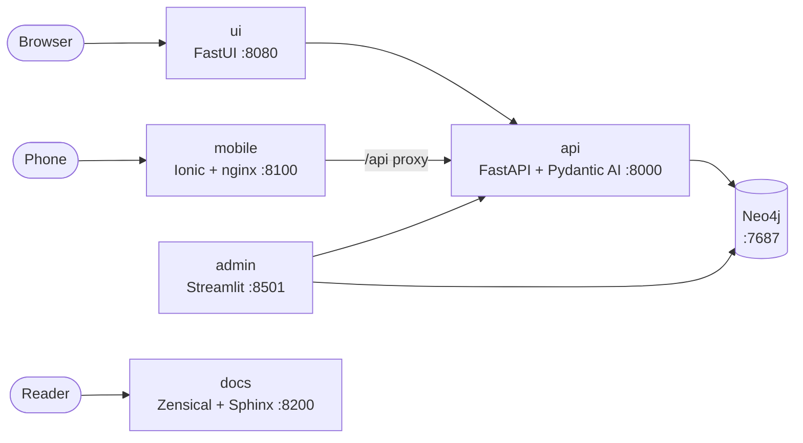

# Architecture

Every frontend talks to the API over HTTP; only the API (and the admin portal, for
administration) touches the graph. One set of Pydantic models is the contract between
all of them.



## Flows

| From | To | How |
|---|---|---|
| `ui` | `api` | Server-side `httpx`; FastUI renders the JSON components in the browser |
| `mobile` | `api` | Browser calls `/api/*` on its own origin; nginx proxies to the API, so no CORS |
| native app | `api` | Direct HTTPS; its origin must be listed in `CORS_ORIGINS` |
| `admin` | `api` and `neo4j` | Health from the API, statistics straight from the graph |
| `api` | `neo4j` | Async Neo4j driver in `app.db.ItemRepo` |
| `docs` | none | Static HTML built from `docs/content` and the code |

## One contract, every surface

| Concern | Source of truth | Used by |
|---|---|---|
| Data shapes | `src/app/models.py` | API, UI, admin, tests; generated into `mobile/src/app/core/api.types.ts` by `uv run task types` |
| Configuration | `src/app/config.py` (`Settings`) | Every Python service |
| Identity, theme, images | `brand/brand.toml` and `brand/images` | Every service; `task sync` for the docs and mobile builds |
| Pages | `brand/content/site.json`, served at `GET /site` | Web UI and mobile app |
| HTTP API | FastAPI's OpenAPI schema | Swagger UI and the generated [HTTP API](../reference/http-api.md) page |
| Docs reference | `python -m app.docgen` | Both docs sites |

## Repository layout

```text
brand/          the brand: brand.toml, content/site.json, images, docs pages; see Brand kit
examples/brands/neutral/   a neutral brand to start from
src/app/
  api/          FastAPI service (GET /health, /site, /items; POST /items, /ask)
  ui/           FastUI web frontend
  admin/        Streamlit admin portal
  content/      the site manifest loader (the manifest is brand/content/site.json)
  meta.py       reads brand/brand.toml for the services and docs
  models.py     the shared Pydantic contract
  config.py     Settings, from environment variables
  db.py         item storage: Neo4j, or memory with STORAGE=memory
  domain/       entities added with `uv run task new_entity`: models, storage, routes
  agent.py      Pydantic AI agent
  docgen.py     generates the docs reference pages from the code
docs/
  content/      the Markdown pages, shared by both docs sites
  sphinx/       Sphinx + Furo configuration (the manual)
  zensical.toml Zensical configuration (the portal)
mobile/         Ionic + Angular app (its own Docker image)
scripts/        sync_meta.py: copies and checks the brand where it cannot be read
docker/         Dockerfiles, nginx configs, entrypoint
tests/          unit, integration, e2e (Playwright), load (Locust)
```
