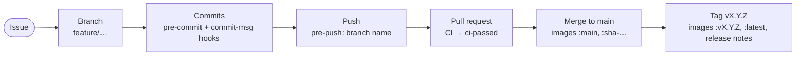

# Ways of working

How a change travels from an idea to a released image. Most of it is enforced by the
pre-commit hooks and CI, so the tools catch a missed step before a reviewer has to.



## One-off setup

```bash
uv sync
uv run pre-commit install    # installs the pre-commit, commit-msg and pre-push hooks
```

See [Getting started](../getting-started.md) for the full set of tools.

## 1. Start from an issue

Every change starts as an issue, so it lands on the GitHub Project. Blank issues are turned
off; pick one of the forms in `.github/ISSUE_TEMPLATE/`:

| Form | For | Asks for |
|---|---|---|
| Feature | new capability or a change in behaviour | a user story and acceptance criteria |
| Bug | something broken | the service, what happened, steps, logs |
| Task | chores, refactors, infrastructure, docs | what needs doing and a definition of done |

The **New templated issue** workflow (Actions tab → Run workflow) creates the same issues
without the web form. Either way, `issue-to-project.yml` adds the issue to the Project once
`PROJECT_URL` is set (see [CI/CD](ci-cd.md#one-off-repository-setup)).

## 2. Branch

Work on a branch, never on `main`: the hooks refuse commits and pushes to `main`. Name the
branch after the kind of work, followed by a lower-case name (`a-z`, `0-9`, `.`, `_`, `-`):

| Issue | Branch | Commit prefix |
|---|---|---|
| Feature | `feature/add-login` | `ADDED:` |
| Bug | `bug/empty-item-name` | `FIXED:` |
| Task | `task/…`, `docs/…` or `refactor/…` | `TASK:`, `DOCS:` or `REFACTOR:` |

```bash
git switch -c feature/add-login
```

A badly named branch is refused at push time; rename it with `git branch -m <new-name>`.

## 3. Commit

Write commit messages as `PREFIX: what changed`, in the present tense, using the prefix from
the table above, e.g. `FIXED: reject items with an empty name`. The `commit-msg` hook refuses a
message without one (merge, revert and `fixup!` commits pass), and the changelog is built from
the prefixes: `uv run task changelog` regenerates `CHANGELOG.md`, and each release's notes on
GitHub come from the same commits (`cliff.toml`).

Every commit runs the pre-commit hooks on the staged files:

| Hook | Checks |
|---|---|
| `trailing-whitespace`, `end-of-file-fixer` | tidy whitespace (fixes it) |
| `check-yaml`, `check-toml` | YAML and TOML files parse |
| `check-added-large-files`, `detect-private-key` | no large files or private keys |
| `no-commit-to-branch` | you are not on `main` |
| `sync-meta` | the brand is valid and its copies are current (fix with `uv run task sync`) |
| `api-types` | the mobile app's TypeScript types match the models (fix with `uv run task types`) |
| `commit-msg` (commit-msg stage) | the message starts with a prefix from the table above |
| `ruff-check`, `ruff-format` | lint and format Python (fixes what it can) |
| `uv-lock` | `uv.lock` matches `pyproject.toml` |
| `actionlint` | the GitHub workflows are valid |

When a hook fixes a file, the commit stops: review the change, `git add` it and commit again.

## 4. Check locally

Run the cheap checks while you work, and the full gate before asking for review on anything
that touches more than one service:

| When | Task | Does |
|---|---|---|
| while coding | `uv run task watch` | re-runs the unit tests on every save |
| before committing | `uv run task format` | formats and auto-fixes Python |
| | `uv run task lint`, `uv run task test` | lint, then unit tests |
| mobile changes | `uv run task test_mobile` | mobile lint and unit tests, in Docker |
| docs changes | `uv run task docs_live` | live preview of the portal |
| before a pull request | `uv run task hooks` | every hook on every file, as CI runs it |
| | `uv run task verify` | the whole CI gate locally, stack included |

Every task is listed in [Tasks](../../reference/tasks.md), and [Testing](testing.md) explains what
each test layer proves.

## 5. Pull request

Push the branch and open a pull request into `main`, linking the issue (`Closes #12`). CI runs
on every push and on the pull request; the single check that matters is **`ci-passed`**, and
once the [`main` ruleset](ci-cd.md#one-off-repository-setup) is in place, nothing merges
without it. [CI/CD](ci-cd.md) lists what each job runs.

A pull request is ready to merge when:

- it meets the issue's acceptance criteria or definition of done;
- tests are added or updated, and `ci-passed` is green;
- the docs match the change: the project's pages in `docs/content/project/`, the template's in
  `docs/content/handbook/` (see [The docs site](../services/docs.md#adding-a-page));
- a [decision record](../decisions/index.md) is added if the change alters how the template is
  structured, built or used;
- `uv run task sync` has been run if anything in `brand/` changed.

Merge with a merge commit, then delete the branch.

## 6. Release

Merging to `main` re-runs CI and pushes every service image to GHCR as `:main` and
`:sha-<commit>`. To release, bump `version` in `pyproject.toml` through a pull request, then
tag the merged commit:

```bash
git switch main && git pull
git tag v0.2.0 && git push origin v0.2.0
```

The tag re-tags the already-tested images as `:v0.2.0` and `:latest`, with no rebuild, and
publishes a GitHub release whose notes are the commits since the last tag, grouped by prefix.
It fails if the commit never went through `main`. Run `uv run task changelog` in the version
bump's pull request so `CHANGELOG.md` matches. Every image is signed and carries an SBOM; see
[CI/CD](ci-cd.md#verifying-a-release-image). Deploy it as described in
[Environments](environments.md).

## Housekeeping

- `uv run pre-commit autoupdate` to bump the hook versions, in a `task/` branch.
- `uv run task clean` to reclaim disk space; `uv sync` rebuilds the virtualenv.
