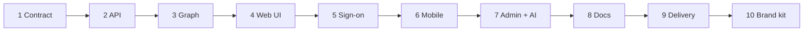

# Build it from scratch

The template is easiest to understand in the order it could have been built: each stage
below adds one capability to a stack that already runs, and says how to check it. Follow it to
rebuild the template in an empty repository, to learn the stack, or to see where to stop if a
project needs less. Every file named here exists in the template; read it alongside the
stage.

## 1. The contract

One set of Pydantic models is the contract between every service, and one `Settings` class
reads every environment variable.

| Adds | Files |
|---|---|
| Project and tools | `pyproject.toml` (uv, ruff, pytest, taskipy), `.python-version` |
| Models | `src/app/models.py`: `ItemIn`, `Item`, `Health` |
| Settings | `src/app/config.py` |
| Tests | `tests/unit/test_config.py` |

**Check:** `uv sync && uv run task test`.

## 2. The API, in memory

A FastAPI service that serves the models. Start with an in-memory repository, the same shape
as the Neo4j one to come, so the API runs before any database exists.

| Adds | Files |
|---|---|
| Routes | `src/app/api/main.py`: `GET /health`, `POST /items`, `GET /items` |
| Repository | `MemoryItemRepo` in `src/app/db.py` (the unit tests' `FakeRepo` builds on it) |
| Tests | `tests/unit/test_api.py`, driving the app in-process |

**Check:** `uv run task test`, then `STORAGE=memory uv run uvicorn app.api.main:app` and open
<http://localhost:8000/docs>. `uv run task dev` runs this stage and the web UI together.

## 3. The graph

Neo4j behind the same repository interface, and a compose file with one service.

| Adds | Files |
|---|---|
| Repository | `src/app/db.py`: `ItemRepo` with `ping`, `ensure_schema`, `create`, `list` |
| Stack | `docker-compose.yml` (`neo4j`, `api`), `docker/Dockerfile`, `docker/entrypoint.sh` |
| Environments | `.env.project`, `.env.test` (throwaway values, committed) |
| Tests | `tests/integration/test_stack.py`: writes reach Neo4j |

**Check:** `uv run task up && uv run task test_int`.

## 4. The web UI

A FastUI frontend that talks to the API over HTTP only, and a site manifest so pages are data,
not code.

| Adds | Files |
|---|---|
| Manifest | `GET /site` in `src/app/api/main.py`, `src/app/content/`, the `Site` models |
| Frontend | `src/app/ui/main.py`, the `ui` service in compose |
| Tests | `tests/unit/test_ui.py` (UI wired to the API in-process), `tests/unit/test_content.py` |

**Check:** `uv run task up`, then <http://localhost:8080>.

## 5. Sign-on

Who is signed in, before any real identity provider exists: demo members, signed tokens, and
one dependency that every write asks for.

| Adds | Files |
|---|---|
| Models | `Member`, `LoginIn`, `Session`, `AuthInfo` in `src/app/models.py` |
| API | `src/app/api/auth.py`: `POST /auth/login`, `GET /auth/me`, `CurrentMember` |
| Members | `brand/content/users.json` |
| Tests | `tests/unit/test_auth.py` |

**Check:** `uv run task test`; then, with `AUTH_MODE=mock`, `POST /items` without a token
returns 401. See [Sign-on](sign-on.md).

## 6. The mobile app

An Ionic + Angular app that renders the same manifest, built and tested inside Docker so
nobody needs Node installed.

| Adds | Files |
|---|---|
| App | `mobile/`: the side menu, content and items pages, `ApiService`, the theme maths |
| Image | `docker/mobile.Dockerfile` (lint, unit tests, build), `docker/mobile.nginx.conf` (proxies `/api`) |
| Tests | the `*.spec.ts` files, `tests/e2e/test_mobile.py` on an emulated phone |

**Check:** `uv run task test_mobile`, then <http://localhost:8100> after `task up`.

## 7. Admin and AI

An operator portal that reads Neo4j directly, and a Pydantic AI agent with one tool.

| Adds | Files |
|---|---|
| Admin | `src/app/admin/main.py`, the `admin` service |
| Agent | `src/app/agent.py`, `POST /ask`; `LLM_MODEL=test` uses the offline `TestModel` |
| Tests | `tests/e2e/test_browser.py` (admin), `tests/unit/test_api.py` (`/ask`) |

**Check:** <http://localhost:8501> after `task up`.

## 8. The docs

Reference pages generated from the code, and one set of Markdown pages built by two engines.

| Adds | Files |
|---|---|
| Generator | `src/app/docgen.py`: HTTP API, models, configuration, tasks, metadata |
| Sites | `docs/zensical.toml` (portal), `docs/sphinx/conf.py` (manual), `docs/content/` |
| Image | `docker/docs.Dockerfile`; both builds are strict, so a broken link fails the image |
| Tests | `tests/unit/test_docs.py`, `tests/e2e/test_docs_site.py` |

**Check:** `uv run task docs_serve`, then <http://localhost:8200>.

## 9. Delivery

Hooks that catch mistakes before review, CI that runs the full gate, and a release workflow
that publishes images.

| Adds | Files |
|---|---|
| Hooks | `.pre-commit-config.yaml`, `scripts/check_branch_name.sh` |
| CI | `.github/workflows/ci.yml` (`ci-passed` is the required check), `release.yml` |
| Gate | `task verify` in `pyproject.toml`: lint, unit, stack, integration, browser, load |
| Process | [Ways of working](development/ways-of-working.md), `.github/ISSUE_TEMPLATE/` |

**Check:** `uv run task verify`.

## 10. The brand kit

Everything project-specific moves into one folder, and a script copies it to the places that
cannot read it.

| Adds | Files |
|---|---|
| Brand | `brand/`: `brand.toml`, `content/site.json`, `images/`, `docs/` |
| Sync | `scripts/sync_meta.py`, the `sync-meta` pre-commit hook |
| Example | `examples/brands/neutral/` |
| Tests | `tests/unit/test_sync.py`: copies are current, a swap re-brands everything |

**Check:** `uv run python scripts/sync_meta.py --check --brand examples/brands/neutral` lists
every file the neutral brand would change. See [Brand kit](brand-kit.md).

## Where to stop

A project that needs less can stop after any stage. Stages 1–3 make an API service, 1–4 a web
application, and 6–8 are independent of each other. Remove a service by deleting its folder,
its compose service and its CI job; the tests that need it fail loudly if anything still
refers to it.
