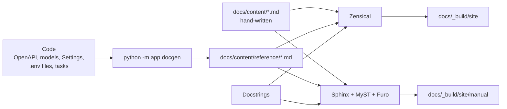

# The docs site

This documentation is built twice from one set of Markdown pages in `docs/content`:

| Site | Engine | URL | Best for |
|---|---|---|---|
| **Portal** | [Zensical](https://zensical.org) | <http://localhost:8200/> | Reading, searching, finding your way |
| **Manual** | [Sphinx](https://www.sphinx-doc.org) + [Furo](https://pradyunsg.me/furo/) | <http://localhost:8200/manual/> | The Python API reference from docstrings |

Zensical is the modern successor to Material for MkDocs, from the same team. Sphinx is the
long-standing standard for Python projects, used by Read the Docs. Running both shows what
each does well, from the same source.

## How the pieces fit

| Path | Role |
|---|---|
| `docs/content/` | Shared pages; Zensical's `docs_dir` and Sphinx's source directory |
| `docs/content/index.md` | Portal home page (Zensical only), generated from `brand/docs/home.md` |
| `docs/content/manual.md` | Manual home page and table of contents (Sphinx only); the handbook's toctrees are generated |
| `docs/content/handbook/` | The template handbook, including the decision records |
| `docs/content/project/` | The project's own pages |
| `docs/content/reference/python-api.md` | Python API via mkdocstrings (Zensical only) |
| `docs/content/reference/python-api-sphinx.md` | Python API via autodoc (Sphinx only) |
| `docs/content/reference/` (the rest) | Generated by `app.docgen`; git-ignored, never edit |
| `docs/content/about.md` | About page, generated from `brand/docs/about.md` |
| `docs/content/assets/brand/` | The brand's images, copied by `task sync`; never edit |
| `docs/content/assets/stylesheets/` | `brand.css` (generated tokens), `template.css`, `zensical.css`, `brand-extra.css` (generated) |
| `docs/zensical.toml` | Portal configuration and navigation |
| `docs/sphinx/conf.py` | Manual configuration; the toctree lives in `manual.md` |

## Adding a page

Pages belong to one of three owners, which decides where they go:

| Page | Write it in | List it in |
|---|---|---|
| The project's own | `docs/content/project/<page>.md` | `Project` in `docs/zensical.toml` and the Project toctree in `docs/content/manual.md` |
| The docs home and about page | `brand/docs/home.md`, `brand/docs/about.md` | nowhere: `task sync` copies them to `index.md` and `about.md` |
| The template handbook | `docs/content/handbook/<page>.md`, in the template repository | `HANDBOOK` in `scripts/sync_meta.py`, then `uv run task sync` writes both navigations |

A unit test fails if a page is missing from either site's navigation. `uv run task docs`
builds both sites; both run in strict mode, so a broken link fails the build.

A project can leave the handbook out of its published docs with `include_handbook = false`
under `[docs]` in `brand/brand.toml`: `task sync` drops it from both navigations and excludes
the folder from both builds. Pages that link into the handbook (the default `brand/docs`
home page does) then fail the strict build until those links go.

Use Markdown both engines understand: headings, tables, fenced code, `mermaid` fences, and
links to other `.md` files. Images take an optional class in braces, for example
`{.brand-crest}`. Keep engine-specific syntax
(Zensical grid cards, Sphinx directives) to the two home pages and the Python API pages.

## The brand theme

Both sites take their colours from the brand: `[theme.docs]` in `brand/brand.toml`, or the
app palette when that table is left out (see [Brand kit](../brand-kit.md)). `task sync`
writes them as `--brand-*` custom properties to `assets/stylesheets/brand.css`:

| Token | Use |
|---|---|
| `--brand-background`, `--brand-surface`, `--brand-card`, `--brand-border` | Page, header and sidebar, cards and code, rules |
| `--brand-accent`, `--brand-accent-2` | Links and accents, hover and highlights (dark scheme) |
| `--brand-accent-ink`, `--brand-accent-2-ink` | The same roles on white (light scheme) |
| `--brand-text`, `--brand-text-muted`, `--brand-text-subtle` | Body text and quieter text (dark scheme) |
| `--brand-gradient`, `--brand-glow` | Headline gradient, card hover glow |

`template.css` holds the engine-neutral pieces (hero, crest, kicker labels);
`zensical.css` and `docs/sphinx/_static/furo.css` map the tokens onto each theme, and
`docs/sphinx/conf.py` sets Furo's colour variables to the same tokens. None of these files
holds a colour, so a new brand needs no stylesheet edits; anything the tokens cannot express
goes in `brand/styles/docs.css`, which sync copies to `brand-extra.css`, loaded last.

The template's default brand sets a neon look: dark first, two bright accents, and deeper
versions of them on white for WCAG AA contrast.

## Images

The brand's images are copied to `docs/content/assets/brand` by `task sync`; pages refer to
them there. Every image scales to its container (`max-width: 100%; height: auto`), and the
crest is capped with `width: min(100%, 18rem)` so it never overflows a phone screen.

Zensical rebuilds its whole output folder on every build, so `task docs` always builds the
portal first and the manual into `site/manual` second. While `task docs_live` is running, read
the manual through `task docs_live_manual` instead.

## Serving

`docker/docs.Dockerfile` generates the reference, builds both sites (the manual in strict
mode) and serves them with nginx: the portal at `/`, the manual at `/manual/`. A docs
warning therefore fails the image build, `task up` and the release, like a failing test.
