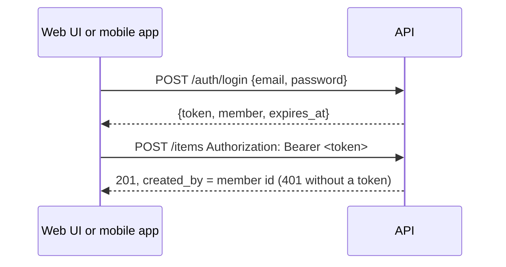

# Sign-on

The template ships a **mock** sign-on: real enough to build and test every screen that depends
on who is signed in, and shaped like a real identity provider, so replacing it later touches
token issuing and the sign-in screens and nothing else. It is a demo, not security.

## Modes

`[auth] mode` in `brand/brand.toml` sets the default; the `AUTH_MODE` setting overrides it per
environment.

| Mode | Who can write | Use it for |
|---|---|---|
| `mock` | Demo members who sign in with the one `AUTH_DEMO_PASSWORD` (default `demo`) | Demos, screen design, the browser tests |
| `off` | Everyone: each request is a fixed local member (`local`, role `admin`) | Quick local experiments, the load test |

Reads (`GET /items`, `GET /site`) are public in both modes; writes (`POST /items`,
`POST /ask`) need a member, and every item records who added it in `created_by`.

## Demo members

`brand/content/users.json` lists them, so a project's personas fit its domain:

```json
[
  { "id": "ada", "name": "Ada Lovelace", "email": "ada@example.org", "role": "admin" },
  { "id": "alan", "name": "Alan Turing", "email": "alan@example.org", "role": "member" }
]
```

`GET /site` includes them (never the password) under `auth.demo_users`, so the frontends can
offer one-click "Sign in as…" buttons.

## On each surface

| Surface | Signing in | Who is signed in | Signing out |
|---|---|---|---|
| Web UI | `/login`: email and password, or one click on a demo member | The navbar shows their name; it opens an account panel | **Sign out** in the panel |
| Mobile app | **Sign in** in the toolbar or side menu: email and password; a demo member fills in the email | The toolbar shows their initials; they open a popover. The side menu shows name and role | **Sign out** in the popover, the side menu or `/account` |
| Admin portal | Email and password; only `admin` members get in | The sidebar | **Sign out** in the sidebar |

Signed out, the items forms on the web and mobile offer **Sign in** instead.

## How it works



| Piece | Where |
|---|---|
| Models: `Member`, `LoginIn`, `Session`, `AuthInfo` | `src/app/models.py` |
| Settings: `AUTH_MODE`, `AUTH_SECRET`, `AUTH_DEMO_PASSWORD`, `AUTH_TTL_MINUTES`, `AUTH_ALLOW_MOCK` | `src/app/config.py`, see [Configuration](../reference/configuration.md) |
| Tokens (HS256 JWT, PyJWT), `/auth/login`, `/auth/me`, `CurrentMember`, `require_role` | `src/app/api/auth.py` |
| Web UI: the login pages, the `HttpOnly` session cookie, the account panel | `src/app/ui/main.py` |
| Mobile: session, interceptor, guard, sign-in page, account menu | `mobile/src/app/core/`, `pages/sign-in/`, `shared/account-menu.component.ts` |
| Admin: the admin-only gate | `src/app/admin/main.py` |

## In production

The API refuses to start with `APP_ENV=production` if sign-on is `mock` (set
`AUTH_ALLOW_MOCK=true` only for a deliberately public demo), or if it issues tokens while
`AUTH_SECRET` is still the default; give it a long random one. With sign-on `off` anyone can
write, which is what the template did before sign-on existed: put a real provider in front
before the data matters.

## Replacing it with a real provider

Keep the shapes and change what issues and checks the token:

1. **API**: verify tokens from your provider (Keycloak, Entra ID, Auth0, Cognito, …) against its
   JWKS URL instead of `AUTH_SECRET`: PyJWT's `PyJWKClient` does this, and `verify` in
   `src/app/api/auth.py` is the one function to change. Map the provider's claims to `Member`.
   Remove `/auth/login`: the provider signs people in.
2. **Frontends**: replace the sign-in screens with the provider's flow: the authorization-code
   flow server-side in the web UI (Authlib), which keeps the same `HttpOnly` cookie, and PKCE
   through a Capacitor OAuth plugin in the mobile app, which keeps `SessionService`'s signals
   and the interceptor. Streamlit's `st.login()` does the same for the admin portal. They keep
   sending `Authorization: Bearer <token>`.
3. **Everything else** (`CurrentMember`, `require_role`, `created_by`, the tests that use a
   signed-in member) stays as it is.
