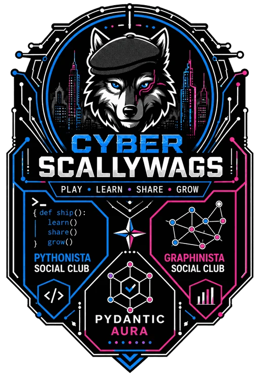

<!-- GENERATED by scripts/sync_meta.py from brand/. Edit that, then run `uv run task sync`. -->

Cyber Scallywags · Docs portal

# Sgaffald

Scaffolding for the next project: an API, a web UI, an admin portal, a mobile app and a
graph, tested and deployable from the first commit.

[Get started](handbook/getting-started.md){ .md-button .md-button--primary }
[Reference manual](/manual/){ .md-button }

-   **Get started**

    ---

    Install the tools, start the stack and find every service.

    [Getting started →](handbook/getting-started.md)

-   **Architecture**

    ---

    How the API, UI, admin, mobile app and Neo4j fit together.

    [Architecture →](handbook/architecture.md)

-   **Site manifest**

    ---

    One JSON file drives the brand, theme and pages on web and mobile.

    [Site manifest →](handbook/site-manifest.md)

-   **HTTP API**

    ---

    Every endpoint with parameters, bodies and `curl` examples, generated from the code.

    [HTTP API →](reference/http-api.md)

-   **Configuration**

    ---

    Every setting and environment variable, test and production.

    [Configuration →](reference/configuration.md)

-   **About Cyber Scallywags**

    ---

    Play • Learn • Share • Grow. The collective behind the template.

    [About →](about.md)

## Two ways to read

This **portal**, built with Zensical, is the quickest way around. The
[reference manual](/manual/), built with Sphinx and Furo, renders the same pages plus the
Python API from docstrings. Both come from `docs/content`; see
[The docs site](handbook/services/docs.md).
