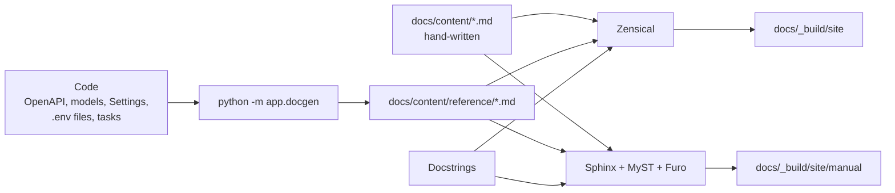

# The docs site

This documentation is built twice from one set of Markdown pages in `docs/content`:

| Site | Engine | URL | Best for |
|---|---|---|---|
| **Portal** | [Zensical](https://zensical.org) | <http://localhost:8200/> | Reading, searching, finding your way |
| **Manual** | [Sphinx](https://www.sphinx-doc.org) + [Furo](https://pradyunsg.me/furo/) | <http://localhost:8200/manual/> | The Python API reference from docstrings |

Zensical is the modern successor to Material for MkDocs, from the same team. Sphinx is the
long-standing standard for Python projects, used by Read the Docs. Running both shows what
each does well, from the same source.

## How the pieces fit

| Path | Role |
|---|---|
| `docs/content/` | Shared pages; Zensical's `docs_dir` and Sphinx's source directory |
| `docs/content/index.md` | Portal home page (Zensical only) |
| `docs/content/manual.md` | Manual home page and table of contents (Sphinx only) |
| `docs/content/reference/python-api.md` | Python API via mkdocstrings (Zensical only) |
| `docs/content/reference/python-api-sphinx.md` | Python API via autodoc (Sphinx only) |
| `docs/content/reference/` (the rest) | Generated by `app.docgen`; git-ignored, never edit |
| `docs/content/assets/` | Images and the shared Scallywag stylesheet |
| `docs/zensical.toml` | Portal configuration and navigation |
| `docs/sphinx/conf.py` | Manual configuration; the toctree lives in `manual.md` |

## Adding a page

1. Write `docs/content/<section>/<page>.md`.
2. Add it to `nav` in `docs/zensical.toml` and to the matching toctree in `docs/content/manual.md`.
   A unit test fails if a page is missing from either.
3. `uv run task docs` builds both sites; Sphinx runs in strict mode, so a broken link fails it.

Use Markdown both engines understand: headings, tables, fenced code, `mermaid` fences, and
links to other `.md` files. Images take an optional class in braces, for example
`{.csw-crest}`. Keep engine-specific syntax
(Zensical grid cards, Sphinx directives) to the two home pages and the Python API pages.

## The Scallywag Neon theme

Both sites share the look of [cyberscallywags.com](https://cyberscallywags.com):

| Token | Value | Use |
|---|---|---|
| Night | `#0b0e14` | Page background (dark) |
| Surface | `#161b22` | Header, sidebar |
| Card | `#1d242e` | Cards, code blocks |
| Border | `#30363d` | Rules, outlines |
| Scallywag blue | `#00e5ff` | Links, accents |
| Scallywag magenta | `#ff007f` | Hover, highlights |

Dark is the default; the light scheme swaps in deeper teal and magenta so text keeps WCAG AA
contrast on white. Headings carry the site's blue-to-magenta gradient, small labels use
monospace capitals, and cards glow blue on hover.

`docs/content/assets/stylesheets/scallywag.css` holds the tokens and shared pieces (hero,
crest, kicker labels). `zensical.css` and `docs/sphinx/_static/furo.css` map the tokens onto
each theme's own variables.

## Images

Images live in `docs/content/assets/images`. Every image scales to its container
(`max-width: 100%; height: auto`), and the crest is capped with
`width: min(100%, 18rem)` so it never overflows a phone screen. The portal hero serves WebP
at 256 or 512 px through `srcset`, so phones download the small one.

Zensical rebuilds its whole output folder on every build, so `task docs` always builds the
portal first and the manual into `site/manual` second. While `task docs_live` is running, read
the manual through `task docs_live_manual` instead.

## Serving

`docker/docs.Dockerfile` generates the reference, builds both sites (the manual in strict
mode) and serves them with nginx: the portal at `/`, the manual at `/manual/`. A docs
warning therefore fails the image build, `task up` and the release, like a failing test.
