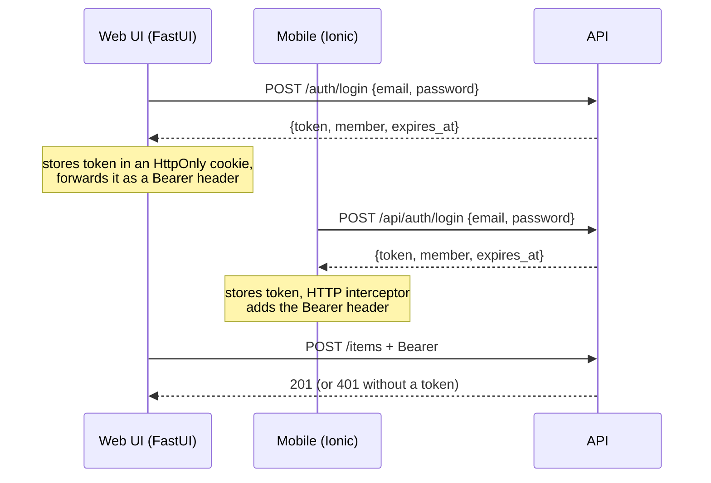

# Brand kit, template handbook and mock sign-on: proposal

Written: 29 October 2026. Scope: how Sgaffald is re-branded for a new project, how its
documentation is organised, a simulated sign-on across API, web UI and mobile, and what it would
take to publish the template as an open-source project. Nothing here is implemented yet; each
section ends with the changes it implies.

This document merges two earlier drafts, `brand-kit-and-sign-on-proposal.md` (the base) and
`brand-isolation-and-sign-on-proposal.md`, and replaces both.

## Summary

1. **One `brand/` folder holds everything a new project changes**: identity, theme colours,
   imagery, docs home and about pages, sample content and demo users. The template's code never
   needs editing to re-brand. `uv run task sync` (already in place) copies the brand into the
   files that cannot read it, and its drift check grows to cover images too.
2. **Split the docs into a template handbook and project docs.** The handbook (ways of working,
   testing, CI/CD, services, "build it from scratch") is owned by the template and never edited
   by a project, so later template fixes merge cleanly. Project docs start almost empty.
3. **Mock sign-on, end to end, with the same shape as a real one.** The API issues a signed
   bearer token for a demo user, and a FastAPI dependency protects the write endpoints. The web
   UI gets a sign-in page and an account menu in the navbar. The existing mobile sign-in page
   calls the API instead of only storing a name, and a toolbar account menu is added. Swapping in
   a real identity provider later changes token verification and the sign-in screens, not the
   rest of the code.
4. **To publish the template**:
   - add a licence;
   - ship a neutral default brand, with Cyber Scallywags as an example brand;
   - default to Neo4j Community instead of the Enterprise evaluation licence;
   - replace the manual rename steps with a Copier template;
   - add a CI job that generates a project from the template and tests it;
   - harden the supply chain (code scanning, SBOM, signed images).

Suggested order: brand kit → docs split → mock sign-on → open-source readiness → adoption
tooling. Each phase is one or two PRs and leaves `uv run task verify` green.

## 1. Where re-branding effort goes today

`project.toml` and `uv run task sync` already handle identity well: one file, a generator, and a
unit test that fails when a generated copy is stale. The remaining friction is everything the
sync does not cover:

| What | Where it is hard-coded today | Problem |
|---|---|---|
| Hero image | `README.md` line 3, `docs/content/index.md` | Path and alt text edited by hand in two places |
| Crest | `docs/content/index.md` (`<picture>` with two WebP sizes and a PNG), `docs/content/about.md` | Three files per image, fixed pixel sizes in the markup |
| Logo and favicon | `docs/zensical.toml` (`logo`, `favicon`), `docs/sphinx/conf.py` (`html_logo`, `html_favicon`), `mobile/src/assets/icon/favicon.png` | Four settings, two engines, no check that they agree |
| Web UI logo and favicon | none | The FastUI navbar shows only the name; the browser tab has no icon |
| Docs colours | `docs/content/assets/stylesheets/scallywag.css` (`--csw-*` tokens), mapped by `zensical.css` and `sphinx/_static/furo.css`; a second copy as hex literals in `docs/sphinx/conf.py` (Furo `light_css_variables` / `dark_css_variables`) | Organisation-named tokens; the docs ignore `theme.primary` etc. from `site.json`, so the docs and the apps can disagree |
| Theme colours | `src/sgaffald/content/site.json` | Brand data mixed in with page content |
| Home and about pages | `docs/content/index.md`, `about.md` | Organisation copy sits inside the template's docs tree |
| Native app icon and splash | none | Needed before a Capacitor build reaches a store |
| Tests | `tests/unit/test_docs.py` (`PROJECT_SLUG`), `tests/e2e/test_docs_site.py` (`h1#sgaffald`) | A renamed project must edit tests by hand |

`git grep -il scallywag` finds 25 files. About half are brand content and half are template
mechanics. The aim is for that grep to hit only `brand/` and the example brand.

## 2. Proposed `brand/` folder

```text
brand/
├── README.md               what every file is for, required sizes, how to check them
├── brand.toml              identity + theme + image map  (replaces project.toml)
├── content/
│   ├── site.json           welcome, about and sidebar pages  (moved from src/sgaffald/content/)
│   └── users.json          demo sign-on personas (section 4)
├── images/
│   ├── logo.svg            full logo, any size
│   ├── mark.svg            square mark for navbars and app icons
│   ├── hero.svg            README and docs home banner (WebP generated)
│   ├── crest.png           optional emblem for the docs home and about pages
│   ├── app-icon.png        1024×1024, no transparency (store requirement)
│   └── splash.png          2732×2732, artwork centred in the middle third
├── styles/
│   └── docs.css            optional docs-only overrides (fonts, hero layout)
└── docs/
    ├── home.md             becomes docs/content/index.md
    └── about.md            becomes docs/content/about.md
```

The rule for a new project: **edit `brand/`, replace the sample domain (`Item`), write project
docs. Nothing else.**

### 2.1 `brand.toml`

`project.toml` keeps its four tables and gains the theme, the image map and the docs options, so
all the variables a re-brand needs sit in one file:

```toml
[project]
name = "Sgaffald"
slug = "sgaffald"
description = "A full-stack starter: FastAPI, FastUI, Streamlit, Ionic and Neo4j"
year = 2026

[organisation]
name = "Sgaffald contributors"
url = "https://github.com/cyberscallywags/sgaffald"
motto = ""

[repository]
owner = "cyberscallywags"
name = "sgaffald"

[mobile]
app_id = "com.cyberscallywags.sgaffald"

[theme]                       # moved from site.json; still served by GET /site
primary = "#1b4965"
secondary = "#5fa8d3"
tertiary = "#e4572e"
font_family = "system-ui, -apple-system, 'Segoe UI', Roboto, sans-serif"
docs_scheme = "dark"          # first scheme of the docs sites; readers can switch

[images]                      # paths relative to brand/images; omit one to hide it
logo = "logo.svg"
mark = "mark.svg"
hero = "hero.svg"
hero_alt = "Sgaffald: scaffolding for the next project"
crest = "crest.png"
crest_alt = "…"
app_icon = "app-icon.png"
splash = "splash.png"

[docs]
include_handbook = true       # false hides the template handbook in a project's published docs

[auth]                        # section 4
mode = "mock"
```

`site.json` keeps only content (`brand.tagline`, `welcome`, `about`, `pages`). `brand.name` and
`brand.collective` keep their current defaults from `[project]` and `[organisation]`.

**Trade-off of moving `[theme]`:** colours are needed at build time: the mobile first paint, both
docs themes and the app icons. That makes them identity, not page content. The cost is that a
runtime colour change becomes "mount a different `BRAND_DIR` and restart" instead of swapping
`SITE_FILE`. Neither frontend changes, because `GET /site` still returns `theme`. See the open
questions.

### 2.2 What `task sync` gains

`scripts/sync_meta.py` already uses a table of output files and renderers. It gains:

- **Image copies.** Every image in `[images]` is copied to `docs/content/assets/brand/`,
  `mobile/src/assets/brand/` and `src/sgaffald/ui/static/` (the web UI). Copies are committed,
  like the other generated files, so Docker build contexts need no change. `--check` compares
  hashes, so a stale copy fails `uv run task test`.
- **Image references.** These all point at the copied files under fixed names, so no image path
  is edited by hand any more:
  - the README hero, in a new `sync:hero` marker block, with `hero_alt`;
  - `logo` and `favicon` in `zensical.toml`;
  - `html_logo` and `html_favicon` in Sphinx, which `conf.py` reads from `brand.toml` (it
    already reads `meta`);
  - the docs home hero.
- **Docs tokens.** `scallywag.css` becomes `brand.css`, generated from `[theme]`. `--csw-*`
  becomes `--brand-*`, and `zensical.css`, `furo.css` and the Furo variables in `conf.py` map
  those instead. The docs then use the same colours as the web UI and mobile app. Layout rules
  that only reference `var(--brand-*)` stay in the template, with neutral class names such as
  `.brand-hero` and `.brand-kicker`. Anything the generator cannot express goes in
  `brand/styles/docs.css`, copied verbatim.
- **Brand docs pages.** `brand/docs/*.md` are copied to `docs/content/` with a GENERATED note.
- **Validation**, run by `--check`:
  - required images exist;
  - PNG dimensions match (the PNG header can be read with the standard library, so the script
    stays stdlib-only);
  - each theme colour reaches WCAG AA against its computed contrast colour (`contrast_for()`
    already does half of this);
  - `site.json` validates against `models.Site`.
- **Optional derivation.** A separate `uv run task brand_images` derives the WebP heroes, the
  64 and 128 px marks, `favicon.png` and the Capacitor icon and splash sets from the master
  images. It uses Pillow from a `brand` dependency group, so CI and the sync stay light. Teams
  that already have their asset sizes can skip it.

### 2.3 Runtime changes

- `sgaffald.meta` reads `brand/brand.toml`. The wheel force-includes `brand/brand.toml` and
  `brand/content/`, as it does `project.toml` today.
- `SITE_FILE` becomes `BRAND_DIR` (default: the bundled brand). One built image can then be
  re-branded at deploy time by mounting a different `brand/` folder. This is useful for
  white-label deployments and for demos.
- The web UI serves `/static/favicon.png` and `/static/mark.svg`. `html_landing()` already
  injects the theme CSS, and it also adds the favicon `<link>`. FastUI's `Navbar` title is text
  only, so the navbar logo is a small CSS addition on `.navbar-brand`, not a component change.
- `tests/unit/test_docs.py` and `tests/e2e/test_docs_site.py` read the slug and name from
  `get_meta()`, so a renamed project needs no test edits.

**Changes:**
- New `brand/`; `project.toml` → `brand/brand.toml`; `site.json` moved.
- Code: `meta.py`, `content/__init__.py`, `config.py` (`BRAND_DIR`), `sync_meta.py` (with tests
  in `test_sync.py`), `ui/main.py`.
- Docs config: `zensical.toml`, `sphinx/conf.py`, the three docs stylesheets.
- `pyproject.toml` force-include; the two docs tests.
- `README.md` steps 2, 4 and 7 collapse into one.

## 3. Template handbook vs project docs

Today every page lives in one tree. A project that edits `ways-of-working.md` or
`services/api.md` gets merge conflicts each time it pulls a template fix. Split by ownership:

```text
docs/content/
├── index.md, about.md          GENERATED from brand/docs
├── project/                    OWNED BY THE PROJECT: starts with one page
│   └── overview.md             what this project is, its domain, its decisions
├── handbook/                   OWNED BY THE TEMPLATE: never edited in a project
│   ├── index.md                what the template gives you and how to read this handbook
│   ├── make-it-yours.md        the brand kit, Copier, renaming (absorbs README steps 1–10)
│   ├── upgrade.md              NEW: pulling template fixes into a project (copier update)
│   ├── architecture.md
│   ├── site-manifest.md
│   ├── brand-kit.md            NEW: every brand.toml field and image, with required sizes
│   ├── sign-on.md              NEW: the mock, and how to replace it (section 4.6)
│   ├── services/               api, web-ui, admin, mobile, docs
│   ├── development/            ways-of-working, testing, environments, ci-cd
│   ├── decisions/              ADRs; the existing reports/ become the first entries
│   └── from-scratch/           NEW: rebuild the template in stages (below)
└── reference/                  GENERATED by sgaffald.docgen, unchanged
```

- **Navigation** becomes **Home · Project · Handbook · Reference · About**. With
  `[docs] include_handbook = false`, `task sync` drops the Handbook from the Zensical nav and the
  Sphinx toctrees. A project can then publish docs that cover only itself, while contributors
  still read the handbook locally.
- **Project name in handbook pages.** Handbook pages never hard-code "Sgaffald". Where they name
  the project, they use a placeholder (for example `{{ project.name }}`) that the docs build fills
  in from `brand.toml`, so the handbook reads correctly in any project with no edits. The
  substitution sits in `sgaffald.docgen`, which already writes generated pages, so it works the
  same for Zensical and Sphinx.
- **README** shrinks to a pitch, the quick start and links into the handbook. It currently carries
  the full 10-step rename guide, which then lives in one place.

### 3.1 "From scratch": a guided rebuild

You asked for documentation on recreating the template from a basic, usable implementation. A
staged walkthrough where each stage runs on its own works well for that, and doubles as
onboarding for people new to the stack:

| Stage | Adds | Runs as |
|---|---|---|
| 1. Contract | `models.py`, `config.py`, `meta.py`; pytest | unit tests only |
| 2. API | FastAPI, an in-memory repository, `GET /site`, `/items` | `uvicorn`, Swagger at `/docs` |
| 3. Graph | Neo4j repository behind the same interface; compose with one service | `docker compose up` |
| 4. Web UI | FastUI rendering the manifest | second compose service |
| 5. Sign-on | the mock from section 4 | protected `POST /items` |
| 6. Mobile | Ionic app reading `GET /site` | nginx image proxying `/api` |
| 7. Admin and AI | Streamlit, the Pydantic AI agent on `TestModel` | full stack |
| 8. Docs | docgen, Zensical, Sphinx | docs image |
| 9. Delivery | pre-commit, CI, release workflow, `task verify` | GitHub Actions |
| 10. Brand kit | `brand/`, `task sync`, drift tests | re-branded stack |

Each page lists the files the stage adds, links to them in the template, and says how to check
the stage works. Stage 2's in-memory repository is also worth keeping in the code. An `ItemRepo`
protocol with `MemoryItemRepo` and `Neo4jItemRepo` lets the unit tests and a `STORAGE=memory`
mode run without Neo4j, which lowers the bar for first-time contributors.

**Changes:**
- Move the pages; update the `zensical.toml` nav and the toctrees in `manual.md` together
  (`tests/unit/test_docs.py` checks they match); fix internal links.
- Move `reports/` into `handbook/decisions/`.
- Add the placeholder substitution to `docgen` and the `include_handbook` switch to `sync`.
- Write `brand-kit.md`, `sign-on.md`, `upgrade.md` and `from-scratch/`.

## 4. Mock sign-on

### 4.1 Goals and limits

- **Feels real**: a sign-in page on web and mobile, a signed-in state in the navbar, toolbar and
  side menu, sign-out, and a protected action (creating an item) that fails without a session.
- **Same shape as a real provider**: the frontends send `Authorization: Bearer <token>`, and the
  API resolves it to a `Member` through one FastAPI dependency. Replacing the mock changes how the
  token is issued and verified, nothing downstream.
- **Clearly not security**: demo users live in a committed file and share one demo password. The
  API refuses to start with `AUTH_MODE=mock` when `APP_ENV=production`, unless
  `AUTH_ALLOW_MOCK=true` is set explicitly (for a public demo). It also refuses a default
  `AUTH_SECRET` in production. The sign-in pages say they are a demo.

### 4.2 Flow



### 4.3 API

- **Demo users** live in `brand/content/users.json`, so a project's personas match its domain:

  ```json
  [
    { "id": "ada", "name": "Ada Lovelace", "email": "ada@example.org", "role": "admin" },
    { "id": "alan", "name": "Alan Turing", "email": "alan@example.org", "role": "member" }
  ]
  ```

- **Models** (`models.py`): `Member` (id, name, email, role), `LoginIn` (email, password),
  `Session` (token, member, expires_at). They feed the generated models reference like the rest.
- **Settings** (`config.py`):
  - `auth_mode: Literal["off", "mock"]` (and later `"oidc"`);
  - `auth_secret: SecretStr`;
  - `auth_demo_password`, default `demo`;
  - `auth_ttl_minutes`;
  - `auth_allow_mock`;
  - the production guard, as a model validator.
- **Tokens**: an HS256 JWT (`sub`, `name`, `role`, `exp`) via PyJWT. A hand-rolled HMAC would
  avoid the dependency, but OIDC providers also issue JWTs. The same library can then verify
  RS256 tokens against a JWKS URL when a real provider replaces the mock.
- **Routes**, in a new `api/auth.py` router: `POST /auth/login` and `GET /auth/me`. Sign-out
  happens on the client (it drops the token); a mock needs no server-side revocation.
- **Dependencies**: `CurrentMember` (401 when the token is missing or invalid) and
  `OptionalMember`, plus `require_role("admin")`.
  - `POST /items` and `POST /ask` require a member. `GET` routes stay public, and items record
    `created_by`.
  - `AUTH_MODE=off` resolves every request to a fixed local member, so the integration and load
    tests, and quick local experiments, keep working without signing in.
- **`GET /site`** gains `auth: {mode, demo_users: [{name, email, role}]}`, never the password,
  so both frontends can render a "Sign in as…" shortcut list.
- **CORS**: `allow_headers` adds `Authorization`.

### 4.4 Web UI (FastUI)

- **`/login` page**: a `ModelForm(LoginIn)` plus one-click buttons for each demo user. The UI
  server posts to the API, sets an `HttpOnly`, `SameSite=Lax` cookie holding the token, and
  redirects to the page the user came from. A cookie survives a reload and scripts can't read it.
  The alternative is FastUI's built-in `AuthEvent`, which keeps the token in `sessionStorage` (the
  installed FastUI is 0.9.0). It needs less code, but the token is lost per tab.
- **Forwarding**: `api()` reads the request's cookie and adds the Bearer header, so every API
  call the UI makes is made as the signed-in member.
- **Account menu**: signed out, the navbar's end links show **Sign in**. Signed in, they show
  the member's name, which opens an account panel with name, email, role and **Sign out**.
  - FastUI has no dropdown component, so the proposal is a `c.Modal` opened by a `PageEvent`
    from the navbar link. It is native FastUI, needs no custom React bundle and works on phones.
  - Confirm this in a short spike first. A Bootstrap dropdown would need either FastUI's `Custom`
    component with a bundled renderer or DOM patching outside React; avoid both.
- **Items page**: the form is shown only when signed in; otherwise a prompt links to `/login`.
- `/logout` clears the cookie and goes home.

### 4.5 Mobile (Ionic)

The sign-in page, `SessionService` and the side-menu entry already exist. They move from
"remember a name" to "hold a session":

- `SessionService.signIn(email, password)` calls `POST /api/auth/login` and keeps the `Session`
  (member, token, expiry) in its signal. `signOut()` drops it, and an expired session clears
  itself.
- **Storage**: `localStorage` for now, behind a small storage interface, so a native build can
  switch to `@capacitor/preferences` or a secure-storage plugin without touching callers.
- **`authInterceptor`** (a functional `HttpInterceptorFn`) adds the Bearer header. On a 401 it
  signs out and routes to `/sign-in?returnUrl=…`. **`authGuard`** protects any route that needs a
  member.
- **Sign-in page**: email and password fields replace name and email, plus a "Sign in as…" list
  from `site.auth.demo_users`.
- **Account menu**: an avatar button in each page's toolbar opens an `ion-popover` with the
  member's name, email and role, and **Sign out**. This is the mobile twin of the web navbar
  modal. The side menu keeps its sign-on block, now showing initials, name and role.
- **Items page**: the add form needs a session; otherwise a sign-in prompt.

### 4.6 Admin, tests and the path to a real provider

- **Admin (Streamlit)**: it talks to Neo4j directly and should stay an operator tool on a private
  network. Optionally, add a sign-in form that accepts only `role = admin`, kept in
  `st.session_state`. Streamlit's own `st.login()` (OIDC) replaces it later.
- **Tests**:
  - unit tests for the token round trip, expiry, wrong password, the production guard,
    401/201 on `POST /items`, the UI cookie flow and the navbar state;
  - Jasmine specs for the service, interceptor, guard and popover;
  - Playwright e2e tests that sign in on web and mobile, add an item and sign out.

  `tests/unit/test_content.py` already reserves the `sign-in` slug; add `login` and `account`.
- **`handbook/sign-on.md`** explains how to replace the mock:
  - set `AUTH_MODE=oidc` with an issuer and audience (Keycloak, Entra ID, Auth0, Cognito);
  - the API verifies tokens against the issuer's JWKS;
  - the web UI runs the authorization-code flow server-side (Authlib) and keeps the same cookie;
  - the mobile app uses PKCE through a Capacitor OAuth plugin.

  `Member`, `CurrentMember`, the interceptor and the guards stay as they are. An optional `auth`
  compose profile with Keycloak and a realm pre-loaded from `users.json` lets people try the
  OIDC path locally.

**Changes:**
- API: `models.py`, `config.py`, new `api/auth.py`, `api/main.py` (router, dependencies, CORS),
  `db.py` (`created_by`); `pyjwt` in the `api` extra.
- Web UI: `ui/main.py` (login, cookie, account panel, forwarding).
- Mobile: `session.service.ts`, new `auth.interceptor.ts`, `auth.guard.ts` and
  `account-menu.component.ts`, `main.ts` (interceptor), the sign-in and items pages,
  `app.component.html`.
- Tests in every layer.

## 5. Making it a useful open-source project

Ordered by how much each one matters for publishing.

### 5.1 Before publishing

1. **Licence.** There is no `LICENSE` file, so legally nobody else may use the code. Use
   Apache-2.0 (includes a patent grant) or MIT for the code. **Brand assets need their own
   terms**: the Cyber Scallywags crest and name should not fall under the code licence by
   accident, so add a `brand/LICENSE` or `TRADEMARKS.md` stating they are not covered. Ship the
   neutral default artwork under CC0.
2. **Neutral default brand.** Ship a plain "Sgaffald" brand (simple SVG mark, neutral palette,
   generic home and about pages) and move the Cyber Scallywags look to
   `examples/brands/cyber-scallywags/`. This shows how re-branding works, and adopters do not
   start from another organisation's identity. `BRAND_DIR=examples/brands/cyber-scallywags`
   switches between them.
3. **Neo4j licence default.** Compose defaults to `neo4j:…-enterprise` with
   `NEO4J_ACCEPT_LICENSE_AGREEMENT=eval` (`docker-compose.yml` line 26). Everyone who runs
   `task up` therefore accepts Neo4j's evaluation terms, often without noticing. Default to Neo4j
   Community and make Enterprise opt-in in `.env.test`. The template appears to use no
   Enterprise features; `admin/app.py` only reads the edition from `dbms.components()`.
4. **Community files**:
   - `CONTRIBUTING.md`, pointing at the ways-of-working page;
   - `CODE_OF_CONDUCT.md` (Contributor Covenant);
   - `SECURITY.md` (private vulnerability reporting is a repository setting);
   - `.github/PULL_REQUEST_TEMPLATE.md` and `CODEOWNERS`.
5. **Remove the internal bits**:
   - `reports/`, which moves to ADRs (section 3);
   - organisation-specific copy in the sample `site.json`;
   - the `PROJECT_URL`/`PROJECT_TOKEN` issue-to-project workflows. Make them skip cleanly when
     the variable is unset, so forks don't see red runs.

### 5.2 Make starting a project a single command

6. **Copier instead of manual renaming.** README steps 1–5 become questions in a `copier.yml`:
   create the repo, set the identity, reset the version, set the brand, and rename the package
   (currently done with `perl -pi`).

   ```bash
   uvx copier copy gh:cyberscallywags/sgaffald data-volunteer-network
   # project name? slug? package name? organisation? primary colour? include mobile? admin? AI?
   ```

   Copier writes `.copier-answers.yml`. Later, `uvx copier update` applies template fixes as a
   three-way merge, which works better than `git fetch template && git merge template/main` on a
   renamed package. With the brand kit and handbook split in place, most updates apply without
   conflicts. `task sync` stays the tool for changes after generation.
7. **Optional services.** Copier questions (or compose profiles) to leave out the mobile app,
   admin, the AI agent or the docs image. Many adopters want only API + web + graph.
8. **A template smoke test in CI**: generate a project with deliberately different answers (new
   name, package, colours, the example brand). Then run `task lint`, `task test` and
   `sync --check` in it, and `git grep -i sgaffald` to catch leftovers. This proves the "make it
   yours" promise on every PR. Today nothing tests it.
9. **Version the template itself.** Tag template releases (SemVer) with upgrade notes in
   `handbook/upgrade.md`. Copier records the version a project was generated from, so
   `copier update --vcs-ref vX.Y.Z` can move one release at a time.

### 5.3 Supply chain and maintenance

10. **Dependency updates**: `dependabot.yml` for uv, npm, GitHub Actions and Docker base images,
    grouped weekly. The template pins many fast-moving tools, and adopters inherit stale pins
    otherwise.
11. **Code scanning**: CodeQL (Python and TypeScript) and an OpenSSF Scorecard workflow. Both are
    free for public repositories, and adopters look for them.
12. **Verifiable images**: in `release.yml`, generate an SBOM with syft, sign the GHCR images with
    cosign (keyless, via GitHub OIDC), and attach build provenance. Downstream users can then
    verify what they pull.
13. **Commit prefixes, checked and turned into a changelog**:
    - Add a `commit-msg` pre-commit hook that enforces the `ADDED:`/`FIXED:`/`TASK:`/`DOCS:`/
      `REFACTOR:` prefixes. Today "nothing checks the prefix".
    - Generate `CHANGELOG.md` from them with git-cliff or release-please.
14. **Dependency groups**: carry out the split recommended in `reports/OPTIMISATION-REVIEW.md`
    (focused lint, unit, e2e, load and docs groups; per-job installs in CI). This gives faster CI
    and lighter contributor installs.

### 5.4 Make it pleasant to adopt and extend

15. **Generated TypeScript types.** `openapi-typescript` generates
    `mobile/src/app/core/api.types.ts` from the API's OpenAPI schema, and `sync --check` fails
    when it is stale. This removes the hand-kept mirror in `api.service.ts` ("keep in step with
    the Pydantic contract"), so a model change needs one edit, not two.
16. **Domain scaffold**: `uv run task new_entity Volunteer` generates the model, repository,
    API routes, web UI page, mobile page, menu entry and tests from the `Item` pattern. Replacing
    the sample domain is otherwise the most manual step left after the brand kit.
17. **Storage without Docker**: the `STORAGE=memory` repository from section 3.1, so someone
    evaluating the template can run the API and web UI with `uv run` alone.
18. **Dev container** (`.devcontainer/`) with uv, Node 24 and Docker-in-Docker, so a Codespace
    runs `task verify` with no local setup.
19. **Docs on GitHub Pages**: the docs build is already static. Publish it from the release
    workflow so people can read the handbook before cloning.
20. **Show it working**:
    - screenshots or a short recording of web and mobile side by side in the README, regenerated
      by a Playwright task;
    - GitHub topics (`template`, `fastapi`, `fastui`, `ionic`, `neo4j`, `pydantic-ai`);
    - "Template repository" ticked.
21. **Accessibility in the gate**: axe-core checks in the existing Playwright tests, alongside the
    brand contrast validation from section 2.2, so a new palette cannot quietly fail WCAG.
22. **Internationalisation hook (optional)**: an optional `locale` in `site.json` and per-locale
    page files. It is cheap to add now and costly to retrofit.

## 6. Suggested order and acceptance checks

| Phase | PRs (branch) | Done when |
|---|---|---|
| 1. Brand kit | `refactor/brand-kit`: `brand/` + `brand.toml` + sync images, tokens, docs pages, validation | Changing only `brand/` re-brands the README, both docs sites, web UI and mobile. `sync --check` catches a stale image. `git grep -il scallywag` outside `brand/` and `examples/` is empty. |
| 2. Docs split | `docs/handbook-split`: move pages, nav + toctrees, placeholders, `include_handbook`, new handbook pages | Strict docs builds pass. No project page lives under `handbook/`. With `include_handbook = false`, both sites build without it. |
| 3. Mock sign-on | `feature/mock-sign-on-api`, `feature/mock-sign-on-frontends` | Signed out, `POST /items` returns 401 and the forms prompt for sign-in on both frontends. E2E tests sign in, use the account menu (modal on web, popover on mobile), add an item and sign out. The API refuses mock auth in production. |
| 4. Open source | `task/open-source-readiness`: licence + community files, neutral brand + example brand, Neo4j Community default, Dependabot, CodeQL, Scorecard, SBOM + cosign, commit-msg hook, changelog | The GitHub community profile is complete. `task up` runs without accepting the Enterprise evaluation licence. Release images verify with `cosign verify`. |
| 5. Adoption tooling | `feature/copier-template`, `feature/generated-api-types`, `feature/new-entity-scaffold` | A project generated with Copier passes `task verify` in CI. A changed Pydantic model fails `sync --check` until the TS types are regenerated. `new_entity` produces a passing, working entity. |

Phases 1 and 2 are independent and could run in parallel. Phase 3 depends on phase 1 only for
`users.json`'s location. The Copier template in phase 5 is easiest once the brand kit exists,
because most of its questions map one-to-one onto `brand.toml` fields. The dependency-group split
(item 14) can land at any point.

## Open questions

- **Licence**: Apache-2.0 or MIT for the code, and which terms for the Cyber Scallywags brand
  assets?
- **Default brand**: neutral "Sgaffald", or keep Cyber Scallywags as the default and add a
  neutral example?
- **Theme location**: is moving `theme` from `site.json` into `brand.toml` acceptable, given that
  a runtime colour change then needs a restart with a mounted `BRAND_DIR`?
- **Mock passwords**: one shared demo password (proposed), or click-to-sign-in personas with no
  password at all? The password field makes the screens look like a real sign-in; personas are
  quicker for demos. The proposal offers both on the same page.
- **Web UI token storage**: `HttpOnly` cookie (proposed) or FastUI's `AuthEvent` with
  `sessionStorage` (less code)?
- **Copier**: adopt it as the main path, or keep "Use this template" plus `task sync` and add
  Copier later?
- **Python package name**: keep `sgaffald`, which is fine because identity no longer depends on
  it, or rename it to something neutral such as `app` so generated projects never need to rename
  it? With Copier asking for the package name, this matters less.
