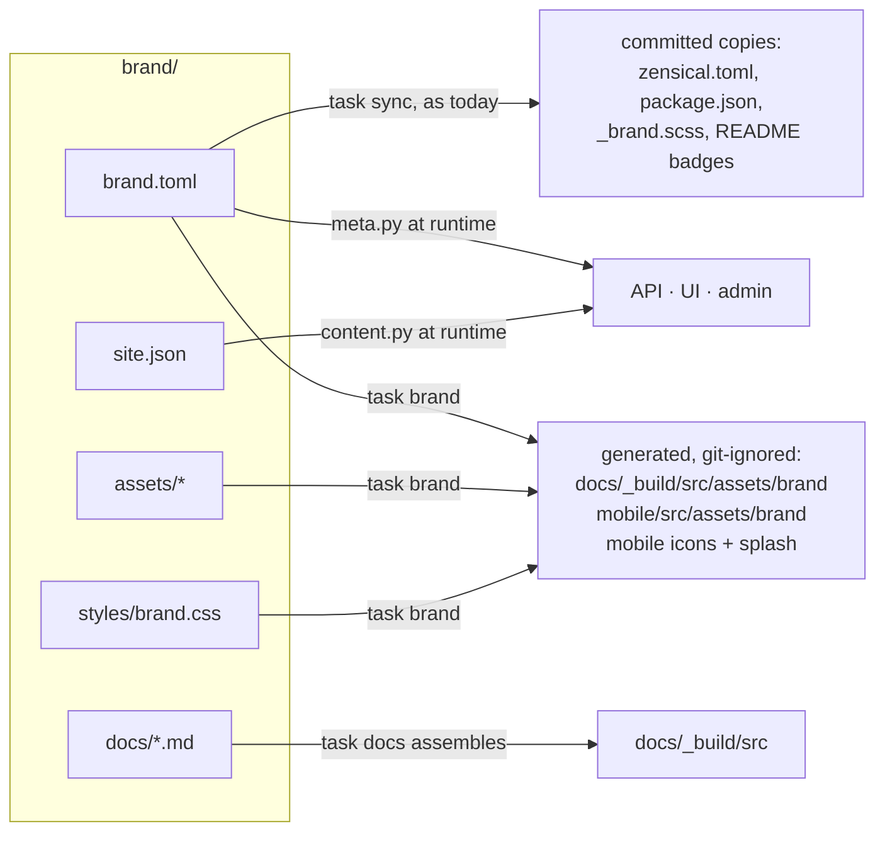
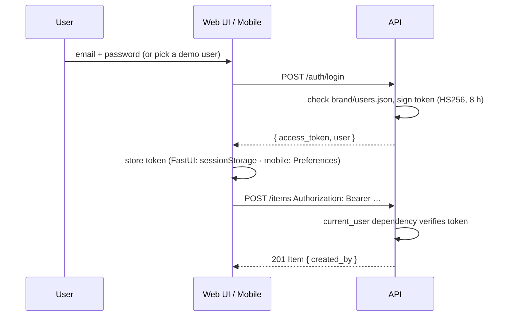

# Proposal: brand isolation, demo sign-on and open-source readiness

Status: **proposal, nothing implemented yet**
Date: 2026-10-29
Branch at time of review: `feature/added_way_of_working` (`2b5caa8`)

## 1. Summary

Sgaffald already separates *identity* (`project.toml`) from *content* (`site.json`), and
`scripts/sync_meta.py` keeps the generated copies in step. This is a good base. The
problem is everything outside those two files. Images, CSS tokens, docs palettes,
hero markup and logo paths are spread across about 25 files in `docs/`, `mobile/`, `README.md`
and `docs/sphinx/conf.py`, and most of them are hard-coded to Cyber Scallywags (`csw-*`).

This proposal makes three changes:

1. **A single `brand/` folder** holds everything project-specific: identity, theme, imagery,
   content, demo users and the project's own docs pages. Nothing else in the repository
   names the brand. Starting a new project means replacing one folder and running one
   command.
2. **Template docs and project docs are separate.** The "how this template works / ways of
   working / rebuild it from scratch" material becomes a self-contained *Template handbook*.
   The project's own pages come from `brand/docs/`.
3. **Demo sign-on across every surface.** One API login endpoint with signed tokens, a login
   page and user dropdown on the web UI, and a real login page on mobile (it replaces today's
   name-and-email placeholder). It behaves like a real implementation and is built so an OIDC
   provider can replace it later without touching the frontends.

Section 6 lists the further changes needed to publish the template as an open-source project.
Two of them block a public release: **there is no `LICENSE`**, and **the default stack runs
Neo4j Enterprise under an evaluation licence**.

---

## 2. Where things stand

### 2.1 What already works well

| Mechanism | Files | Keep? |
|---|---|---|
| Identity in one file, copied by a checker | `project.toml` → `scripts/sync_meta.py` (`--check` in pre-commit and unit tests) | Yes, and extend it |
| Content manifest rendered by both frontends | `src/sgaffald/content/site.json` → `GET /site` → FastUI + Ionic | Yes, but move it |
| Runtime content override | `SITE_FILE` setting | Yes, and generalise it to `BRAND_DIR` |
| Reference docs generated from code | `sgaffald.docgen` | Yes |
| Package name decoupled from identity | `meta.py` reads `project.toml` | Yes |

### 2.2 Brand touchpoints outside the two source files

Currently, changing the look of the project means editing all of these by hand:

| Touchpoint | What is hard-coded |
|---|---|
| `docs/content/assets/images/` (10 files) | `csw-crest-*`, `csw-mark-*`, `sgaffald-hero.*`, `sgaffald-logo.*`, `favicon.png` |
| `docs/content/assets/stylesheets/scallywag.css` | `--csw-*` palette tokens, plus layout rules (hero, kicker, crest) in the same file |
| `docs/content/assets/stylesheets/zensical.css`, `docs/sphinx/_static/furo.css` | Map `--csw-*` tokens onto each theme |
| `docs/sphinx/conf.py` (lines 61–100) | Logo path, favicon path, and a **second copy of the palette as hex literals** |
| `docs/zensical.toml` (lines 60–61) | Logo and favicon paths (outside the `sync:` markers) |
| `docs/content/index.md` | "Cyber Scallywags · Docs portal" kicker, `# Sgaffald` heading, crest `<picture>` |
| `docs/content/about.md` | Crest image and Cyber Scallywags copy |
| `README.md` | Hero image path, "This Cyber Scallywags base template" intro |
| `mobile/src/assets/icon/favicon.png`, `mobile/src/index.html` | Favicon; there are no Capacitor app icons or splash screens yet |
| `tests/unit/test_docs.py`, `tests/e2e/test_docs_site.py` | `PROJECT_SLUG`, `h1#sgaffald` |

There are also **two unrelated palettes**. The apps use `site.json`'s `theme` (navy, sky,
orange). The docs use the neon `--csw-*` palette and the Furo hex values. A new brand has to
set both, and nothing tells it that the second one exists.

### 2.3 Sign-on today

- Mobile has `SessionService` and a `sign-in` page. It stores `{name, email}` in
  `localStorage` and clearly states that it is not authentication.
- The web UI (FastUI) has no sign-on.
- The API has no idea who the caller is. `POST /items` is open, and the CORS settings only
  allow the `Content-Type` header, so `Authorization` would be rejected.
- `sign-in` is already a reserved slug in `models.RESERVED_SLUGS` and `app.routes.ts`.

---

## 3. Target architecture: the `brand/` folder

### 3.1 Layout

```text
brand/                          ← the ONLY folder a new project must replace
├── brand.toml                  identity + theme + asset manifest (replaces project.toml)
├── site.json                   pages and copy (moved from src/sgaffald/content/)
├── users.json                  demo sign-on accounts (see §5)
├── assets/
│   ├── logo.svg                full logo, light and dark safe
│   ├── mark.svg                square mark (navbar, docs logo)
│   ├── hero.webp               README and docs hero, 2:1
│   ├── emblem.png              optional crest/illustration for About
│   ├── favicon.png             ≥ 64×64
│   ├── app-icon.png            1024×1024, source for Capacitor icons
│   └── splash.png              2732×2732, source for Capacitor splash
├── styles/
│   └── brand.css               token VALUES only: --brand-* custom properties
└── docs/
    ├── index.md                project home page of the docs portal
    ├── about.md                the organisation behind the project
    └── …                       any other project-specific pages
```

The template ships **one neutral default brand** in `brand/`, with placeholder SVG artwork
and a plain palette. The Cyber Scallywags brand moves to `examples/brands/cyber-scallywags/`,
or to its own repository (see §6.2 on asset licensing). It is then also a worked example of
swapping a brand.

### 3.2 `brand.toml`

`project.toml` already has the right shape. It gains `[theme]` and `[assets]` sections and
moves into `brand/`:

```toml
[project]
name = "Sgaffald"
slug = "sgaffald"
description = "…"
year = 2026

[organisation]
name = "Cyber Scallywags"
url = "https://cyberscallywags.com"
motto = "Play • Learn • Share • Grow"

[repository]
owner = "cyberscallywags"
name = "sgaffald"

[mobile]
app_id = "com.cyberscallywags.sgaffald"

[theme]                       # ONE palette for apps AND docs (moved out of site.json)
primary   = "#1b4965"
secondary = "#5fa8d3"
tertiary  = "#e4572e"
surface_dark = "#0b0e14"      # docs dark mode background
font_family = "system-ui, …"
docs_scheme = "dark-first"    # or "light-first"

[assets]                      # paths relative to brand/; optional entries may be omitted
logo = "assets/logo.svg"
mark = "assets/mark.svg"
hero = "assets/hero.webp"
favicon = "assets/favicon.png"
emblem = "assets/emblem.png"
app_icon = "assets/app-icon.png"
splash = "assets/splash.png"

[auth]
mode = "demo"                 # off | demo | oidc (see §5)
```

**Why move the theme out of `site.json`?** Colours are needed at build time: first paint on
mobile, the Zensical and Furo themes, and Capacitor icons. They are identity, not page
content. `site.json` keeps only pages and copy. `GET /site` still returns `theme`, which the
API now reads from `brand.toml`, so neither frontend changes.

### 3.3 How each consumer reads the brand



| Consumer | Today | Proposed |
|---|---|---|
| Python services | `project.toml` + `SITE_FILE` | `BRAND_DIR` setting (default `./brand`). In production, mount a brand folder into the containers and swap it **without rebuilding**. |
| Mobile build | `favicon.png` in `src/assets/icon/` | `angular.json` asset glob `{ "input": "../brand/assets", "output": "assets/brand" }`, so the build copies nothing by hand. `@capacitor/assets generate` builds icons and splash screens from `app-icon.png` and `splash.png`. |
| Docs (Zensical + Sphinx) | Pages and assets in `docs/content`, palette in two places | `task docs` first assembles `docs/_build/src` from `docs/handbook/` + `brand/docs/` + `brand/assets`. Both themes read `--brand-*` tokens. `sphinx/conf.py` takes its logo, favicon and Furo colours from `brand.toml` instead of literals. |
| README | Hand-edited hero path | Hero path inside a new `sync:hero` marker block |
| Stylesheets | `scallywag.css` mixes token values with layout rules | Split into `docs/theme/template.css` (layout, references only `var(--brand-*)`, class names `.brand-hero`, `.brand-kicker`, …) and `brand/styles/brand.css` (values only) |

**No symlinks.** They break on Windows checkouts and in some Docker contexts. Generated copies
go under `_build/` or other git-ignored paths. The Docker build contexts for `docs` and
`mobile` gain `brand/`. This also helps with the `.dockerignore` and build-context findings
in `reports/OPTIMISATION-REVIEW.md`.

### 3.4 `task brand` / `sync_meta.py` changes

`scripts/sync_meta.py` already does the hard part. Extend it rather than replacing it:

- **Read** `brand/brand.toml` (with a one-release fallback to the root `project.toml`).
- **Validate** the brand (`--check` also runs these checks, which turn today's silent
  mistakes into failing tests):
  - every `[assets]` path exists, with the expected format and minimum pixel size;
  - the theme colours have readable contrast against white and the dark surface
    (WCAG AA 4.5:1 for text use; `contrast_for()` already has the maths);
  - `site.json` validates against `models.Site`;
  - no file outside `brand/`, `examples/` or `CHANGELOG.md` contains the brand name or slug.
    This turns the README's manual `git grep -i sgaffald` step into a test.
- **Generate** the git-ignored asset copies and `brand-tokens.css` for both docs themes.

### 3.5 Tests that assert the brand

`tests/unit/test_docs.py` (`PROJECT_SLUG`) and `tests/e2e/test_docs_site.py` (`h1#sgaffald`)
should read the slug and name from `get_meta()`, so a renamed project needs no test edits.

---

## 4. Documentation split

The goal is to keep the documentation about the template itself separate from the
project's own documentation.

```text
docs/
├── handbook/                   ← template-owned; new projects keep these untouched
│   ├── getting-started.md
│   ├── architecture.md
│   ├── site-manifest.md
│   ├── brand-folder.md         NEW: the contract in §3, and the checks
│   ├── sign-on.md              NEW: demo mode, then the path to OIDC
│   ├── services/…
│   ├── development/            ways-of-working, testing, environments, ci-cd
│   ├── template/
│   │   ├── start-a-project.md  replaces README §1–10 and guides/make-it-yours.md
│   │   ├── upgrade.md          NEW: pulling template fixes into a project
│   │   └── build-from-scratch.md  NEW: see below
│   └── reference/              generated by docgen, as today
├── theme/                      template.css, zensical.css, furo.css, Sphinx templates
├── zensical.toml
└── sphinx/conf.py
brand/docs/                     ← project-owned: index.md, about.md, domain pages
```

- **Navigation** gets a *Project* section (from `brand/docs`, listed in `brand.toml` or
  auto-discovered) and a *Template handbook* section. A project can hide the handbook in
  production docs with one setting, `docs.include_handbook = false`.
- **`build-from-scratch.md`** is a tutorial that rebuilds the template from a minimal working
  core: API + one content page → add Neo4j → add FastUI → add mobile → add docs → add CI. Each
  step is runnable and links to the commit or file that implements it. Contributors learn
  why each piece exists, and teams that want a smaller stack learn where to stop.
- **README** shrinks to a pitch, a screenshot, the quick start and links. The ten-step
  "start a new project" section moves to `template/start-a-project.md` and drops to about
  four steps once `brand/` and `task init` (§6.1) exist.
- **Placeholders in handbook pages.** Handbook pages that mention the project name use a
  build-time variable, for example a Zensical/Markdown macro or a `docgen` substitution.
  They then read correctly in any project with no edits.

---

## 5. Demo sign-on

Goal: behave like a real implementation, with login, a token on every request, a protected
write and a visible signed-in user, while staying deliberately simple and impossible to ship
to production by accident.

### 5.1 Flow



### 5.2 API (`src/sgaffald/auth.py`, new)

| Piece | Detail |
|---|---|
| Settings | `auth_mode: Literal["off", "demo", "oidc"]` (from `brand.toml`, overridable by env), `auth_secret: SecretStr`, `auth_token_ttl` |
| Users | `brand/users.json`: `[{ "email", "name", "role": "member" \| "admin", "password" }]`. These demo passwords are plain text **on purpose**. The file says so, and the docs say so. |
| Endpoints | `POST /auth/login` → `Token`; `GET /auth/me` → `User`; `GET /auth/users` (demo mode only: names and emails for a "sign in as…" picker, no passwords) |
| Dependencies | `CurrentUser = Annotated[User, Depends(current_user)]`, plus `require_role("admin")` |
| Protection | `POST /items` and `POST /ask` require a user. `GET` stays public, so the content pages work signed out. `Item` gains `created_by`. |
| Tokens | PyJWT, HS256. Real identity providers issue JWTs, so moving to OIDC changes only the verification step (JWKS instead of a shared secret). The frontends do not change. |
| CORS | Add `Authorization` to `allow_headers` |
| Guard rail | Startup **fails** when `app_env == "production"` and `auth_mode == "demo"`, or when `auth_secret` is still the default. `GET /health` reports `auth_mode`. |

### 5.3 Web UI (FastUI)

- **`/login` page**: a `ModelForm` with email and password. In demo mode it also shows a
  table of demo users with "sign in as" buttons. On success the UI backend returns
  `c.FireEvent(event=AuthEvent(token=…, url="/"))`. FastUI's prebuilt frontend stores the
  token and sends it as `Authorization` on every later request, so no custom JavaScript is
  needed.
- **Forwarding**: the UI's `api()` client passes the incoming `Authorization` header through
  to the API.
- **User dropdown**: FastUI has no native dropdown component. Recommended: an end-of-navbar
  link showing the user's name. Clicking it fires a `PageEvent` that opens a `c.Modal` with
  name, email, role and **Sign out**, which acts like a dropdown without a custom frontend
  build. Signed out, the link reads **Sign in**. A true dropdown would need a `c.Custom`
  component and a custom React bundle, which is not worth it for a template.
- The Items form only appears when signed in. Signed out, the page shows a "Sign in to add
  items" link.

### 5.4 Mobile (Ionic)

- **`sign-in` page** becomes email + password, plus an optional "Demo accounts" list that
  fills in the form. It calls `POST /auth/login`.
- **`SessionService`** keeps its public shape (`member` signal, `signIn`, `signOut`). Its
  internals change to store `{ token, user }` with `@capacitor/preferences`, which falls back
  to `localStorage` on the web. Restore checks `GET /auth/me` and drops an expired token.
- **`authInterceptor`** (functional `HttpInterceptorFn`) adds the bearer token. On a 401 it
  signs out and routes to `/sign-in?returnUrl=…`.
- **`authGuard`** on any route that needs a user. Items stays readable, and its add form is
  hidden when signed out, matching the web UI.
- **User dropdown**: an avatar button in each page toolbar opens an `ion-popover` with the
  user's name, role and **Sign out**. The existing sign-on block in the side menu stays.
- `Member` in `api.service.ts` gains `role`. The generated client in §6.1 would remove this
  hand-written mirror.

### 5.5 Admin (Streamlit)

In demo mode, show a small login form that only lets `role == "admin"` users through,
checked with `POST /auth/login`. Later, Streamlit's built-in `st.login()` (OIDC) can replace
it.

### 5.6 Tests

- Unit: token round-trip, expired or tampered token → 401, role checks, production guard
  rail, `users.json` schema.
- Integration: login → create item → `created_by` matches.
- E2E (Playwright, desktop and emulated phone): sign in, see the name in the dropdown, add
  an item, sign out, and check that the add form disappears.

### 5.7 Upgrade path (documented in `handbook/sign-on.md`)

An optional `auth` compose profile with **Keycloak** (or Authentik) and a pre-imported realm
matching `users.json`. `auth_mode = "oidc"` switches the API to JWKS verification, and the
frontends switch to the authorization-code + PKCE flow. Same endpoints, same `CurrentUser`
dependency.

---

## 6. Recommended further enhancements

Ordered by how much they help the "new project" transition and an open-source release.

### 6.1 Make starting a project a single command

| # | Change | Why |
|---|---|---|
| 1 | **`uv run task init`**: an interactive script that asks for name, slug, org, repo and app id, then writes `brand/brand.toml`, resets the version to `0.1.0`, deletes `reports/`, optionally renames the package, and runs `task brand` + `task test` | Replaces the 10 manual steps in the README. The script is plain Python and easy to maintain. |
| 2 | **Consider Copier** (`copier copy` / `copier update`) as a later step | `copier update` re-applies template improvements with three-way merges. This is cleaner than `git merge template/main` across unrelated histories. It costs some Jinja templating, so adopt it once `brand/` has reduced the templated surface. |
| 3 | **In-memory repository + `lite` compose profile** | Give `ItemRepo` a protocol with an in-memory implementation, so `uv run task dev` starts the API + UI with no Docker and no Neo4j. This lowers the barrier for first-time users and makes "very basic usable implementation" literally runnable. |
| 4 | **Generate TypeScript types from OpenAPI** (`openapi-typescript`) into `mobile/src/app/core/api.types.ts`, checked by `--check` | Removes the hand-kept mirror in `api.service.ts`. Domain changes then need one edit, not two. |
| 5 | **Domain scaffold command** (`task new-entity Volunteer`) | Generates model, repo, routes, UI page, mobile page and tests from `Item`. Step 6 of "start a project" is currently the most manual. |
| 6 | **Dev container / Codespaces** (`.devcontainer/`) | Python 3.14, uv, Node and Docker-in-Docker preinstalled, so a first contribution needs no local setup. |

### 6.2 Open-source release blockers

| # | Change | Why |
|---|---|---|
| 1 | **Add a `LICENSE`.** MIT or Apache-2.0 is recommended; Apache-2.0 adds a patent grant. | There is currently no licence. Without one, nobody can legally reuse the code. |
| 2 | **Default to Neo4j Community Edition**; make Enterprise an opt-in profile | `neo4j:…-enterprise` under an evaluation licence is not something third parties can run freely. Check that no Enterprise-only features are used. `dbms.components()` in admin works on both editions. |
| 3 | **Separate the brand licence from the code licence** | The Cyber Scallywags crest and marks should not fall under MIT. Ship neutral default artwork under CC0, and move Cyber Scallywags assets to `examples/` with their own `LICENSE` (or out of the repo). |
| 4 | **Community files**: `CONTRIBUTING.md` (summarising the Ways of Working), `CODE_OF_CONDUCT.md` (Contributor Covenant), `SECURITY.md` (private vulnerability reporting), `.github/pull_request_template.md`, `CODEOWNERS` | GitHub's community profile checks for these, and contributors expect them. |
| 5 | **Remove anything internal**: `reports/` from the published template, private project URLs, and any assumption about `PROJECT_TOKEN` | Clean first impression. Workflows that need secrets should skip gracefully when the secret is absent; they partly do already. |

### 6.3 Supply chain and maintenance

| # | Change | Why |
|---|---|---|
| 1 | **Renovate or Dependabot** for uv, npm, Docker and GitHub Actions | A template is copied many times, so stale pins multiply |
| 2 | **CodeQL** + **OpenSSF Scorecard** workflows | Free for public repos and expected by adopters |
| 3 | **SBOM (syft) + cosign signing + provenance** on release images | Lets downstream users verify `ghcr.io` images |
| 4 | **Conventional Commits mapping + automated changelog** (git-cliff or release-please) | The current `ADDED:`/`FIXED:` prefixes map cleanly onto a generated `CHANGELOG.md`, so changelog upkeep needs no extra work. Add a commit-msg hook, since today "nothing checks the prefix". |
| 5 | **Version the template itself** and publish upgrade notes per release | Projects can then tell which template release they forked from. Pairs with `copier update`. |
| 6 | Implement the **dependency-group split** from `reports/OPTIMISATION-REVIEW.md` | Faster CI and lighter contributor installs |

### 6.4 Quality and reach

| # | Change | Why |
|---|---|---|
| 1 | **Accessibility checks** (`axe-playwright-python`) in the existing e2e suite, plus the colour-contrast check in §3.4 | Brands vary, and the checks stop a new brand from shipping unreadable colour pairs |
| 2 | **Publish the docs to GitHub Pages** from `release.yml` | A browsable demo of the docs without running anything |
| 3 | **Screenshots / short GIF** of web, mobile and docs in the README, regenerated by a Playwright task | Most visitors decide from the README in seconds |
| 4 | **i18n hook in `site.json`** (optional `locale` + per-locale page files) | Cheap now and costly to retrofit, because many potential users are not English-first |
| 5 | **"Good first issue" seed issues** for the roadmap items above | Gives new contributors an obvious entry point |

---

## 7. Implementation plan

Each phase is one PR of reviewable size, named per the Ways of Working. Phases 1–3 are
independent of 4–5.

| Phase | Branch | Scope | Done when |
|---|---|---|---|
| 1 | `refactor/brand-folder` | Create `brand/`; move `project.toml` → `brand/brand.toml` and `site.json` → `brand/site.json`; `BRAND_DIR` setting; theme moves to `brand.toml`; `sync_meta.py` reads the new paths | `task verify` passes with no visible change |
| 2 | `refactor/brand-assets` | Asset manifest; split `scallywag.css` into template + tokens; one palette feeds Zensical, Furo and apps; Angular asset glob; Capacitor icons; brand validation in `--check`; tests read slug from meta | Swapping in a second brand folder rebrands every surface, proven by a test that builds with `examples/brands/…` |
| 3 | `docs/handbook-split` | `docs/handbook/` + `brand/docs/`; docs assembly step; `start-a-project.md`, `brand-folder.md`, `build-from-scratch.md`; slim README | Both doc sites build with `--strict` / `-W`; nav test updated |
| 4 | `feature/demo-sign-on-api` | `auth.py`, endpoints, `CurrentUser`, protected writes, `created_by`, production guard rail, CORS | Unit + integration tests pass |
| 5 | `feature/demo-sign-on-frontends` | FastUI login + navbar modal; mobile login, interceptor, guard, popover; admin gate | E2E sign-in/out passes on desktop and emulated phone |
| 6 | `task/open-source-readiness` | LICENSE, community files, Neo4j Community default, neutral default brand, Renovate, CodeQL, Scorecard | GitHub community profile 100 %; the stack runs with no Enterprise licence |
| 7 | `feature/task-init` | `task init`, in-memory repo + `lite` profile, OpenAPI → TS types | A fresh clone becomes a renamed, passing project in one command |

## 8. Decisions needed

1. **Licence**: MIT or Apache-2.0?
2. **Cyber Scallywags brand**: keep it in this repo as `examples/brands/cyber-scallywags`, or
   move it to a private brand repository and ship only a neutral default?
3. **Theme location**: is moving `theme` from `site.json` into `brand.toml` acceptable? It
   means a runtime colour change needs a container restart (with a mounted `BRAND_DIR`)
   rather than only a `SITE_FILE` swap.
4. **Demo login style**: email + password, a "pick a demo user" list, or both (recommended)?
5. **Copier**: adopt it now, later (recommended, after Phase 2), or never?
6. **Python package name**: keep `sgaffald` (fine, since identity is decoupled), or rename it
   to something neutral such as `app` so forks never need to rename it?
