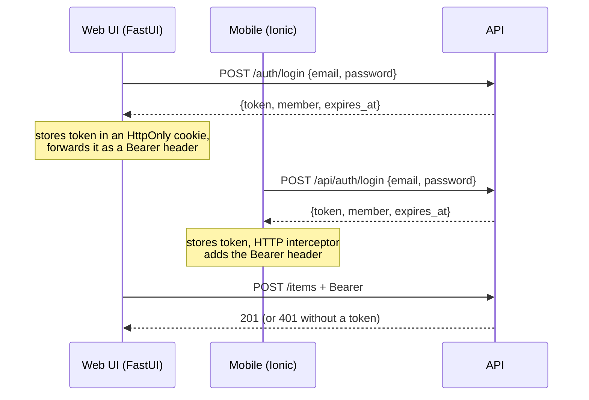

# Brand kit, template handbook and mock sign-on: proposal

Written: 29 October 2026. Scope: how Sgaffald is re-branded for a new project, how its
documentation is organised, a simulated sign-on across API, web UI and mobile, and what it would
take to publish the template as an open-source project. Nothing here is implemented yet; each
section ends with the changes it implies.

## Summary

1. **One `brand/` folder holds everything a new project changes**: identity, theme colours,
   imagery, docs home and about pages, sample content and demo users. The template's code never
   needs editing to re-brand. `uv run task sync` (already in place) copies the brand into the
   files that cannot read it, and its drift check grows to cover images too.
2. **Split the docs into a template handbook and project docs.** The handbook (ways of working,
   testing, CI/CD, services, "build it from scratch") is owned by the template and never edited
   by a project, so later template fixes merge cleanly. Project docs start almost empty.
3. **Mock sign-on, end to end, with the same shape as a real one.** The API issues a signed
   bearer token for a demo user, a FastAPI dependency protects the write endpoints, the web UI
   gets a sign-in page and an account menu in the navbar, and the existing mobile sign-in page
   calls the API instead of only storing a name. Swapping in a real identity provider later
   changes token verification and the sign-in screens, not the rest of the code.
4. **To publish the template**: add a licence, ship a neutral default brand (with Cyber
   Scallywags as an example brand), default to Neo4j Community instead of the Enterprise
   evaluation licence, replace the manual rename steps with a Copier template, and add a CI job
   that generates a project from the template and tests it.

Suggested order: brand kit → docs split → mock sign-on → open-source readiness. Each phase is
one or two PRs and leaves `uv run task verify` green.

## 1. Where re-branding effort goes today

`project.toml` and `uv run task sync` already handle identity well: one file, a generator, and a
unit test that fails when a generated copy is stale. The remaining friction is everything the
sync does not cover:

| What | Where it is hard-coded today | Problem |
|---|---|---|
| Hero image | `README.md` line 3, `docs/content/index.md` | Path and alt text edited by hand in two places |
| Crest | `docs/content/index.md` (`<picture>` with two WebP sizes and a PNG), `docs/content/about.md` | Three files per image, fixed pixel sizes in the markup |
| Logo and favicon | `docs/zensical.toml` (`logo`, `favicon`), `docs/sphinx/conf.py` (`html_logo`, `html_favicon`), `mobile/src/assets/icon/favicon.png` | Four settings, two engines, no check that they agree |
| Web UI logo and favicon | none | The FastUI navbar shows only the name; the browser tab has no icon |
| Docs colours | `docs/content/assets/stylesheets/scallywag.css` (`--csw-*` tokens), mapped by `zensical.css` and `sphinx/_static/furo.css` | Organisation-named tokens; the docs ignore `theme.primary` etc. from `site.json`, so the docs and the apps can disagree |
| Theme colours | `src/sgaffald/content/site.json` | Brand data mixed in with page content |
| Home and about pages | `docs/content/index.md`, `about.md` | Organisation copy sits inside the template's docs tree |
| Native app icon and splash | none | Needed before a Capacitor build reaches a store |

`git grep -i scallywag` finds 25 files; about half are brand content and half are template
mechanics. The aim is for that grep to hit only `brand/` (and the example brand).

## 2. Proposed `brand/` folder

```text
brand/
├── README.md               what every file is for, required sizes, how to check them
├── brand.toml              identity + theme + image map  (replaces project.toml)
├── content/
│   ├── site.json           welcome, about and sidebar pages  (moved from src/sgaffald/content/)
│   └── users.json          demo sign-on personas (section 4)
├── images/
│   ├── logo.svg            full logo, any size
│   ├── mark.svg            square mark for navbars and app icons
│   ├── hero.svg            README and docs home banner (WebP generated)
│   ├── crest.png           optional emblem for the docs home and about pages
│   ├── app-icon.png        1024×1024, no transparency (store requirement)
│   └── splash.png          2732×2732, artwork centred in the middle third
├── styles/
│   └── docs.css            optional docs-only overrides (fonts, hero layout)
└── docs/
    ├── home.md             becomes docs/content/index.md
    └── about.md            becomes docs/content/about.md
```

The rule for a new project: **edit `brand/`, replace the sample domain (`Item`), write project
docs. Nothing else.**

### 2.1 `brand.toml`

`project.toml` keeps its four tables and gains the theme and the image map, so all the
variables a re-brand needs sit in one file:

```toml
[project]
name = "Sgaffald"
slug = "sgaffald"
description = "A full-stack starter: FastAPI, FastUI, Streamlit, Ionic and Neo4j"
year = 2026

[organisation]
name = "Sgaffald contributors"
url = "https://github.com/cyberscallywags/sgaffald"
motto = ""

[repository]
owner = "cyberscallywags"
name = "sgaffald"

[mobile]
app_id = "com.cyberscallywags.sgaffald"

[theme]                       # moved from site.json; still served by GET /site
primary = "#1b4965"
secondary = "#5fa8d3"
tertiary = "#e4572e"
font_family = "system-ui, -apple-system, 'Segoe UI', Roboto, sans-serif"
docs_scheme = "dark"          # first scheme of the docs sites; readers can switch

[images]                      # paths relative to brand/images; omit one to hide it
logo = "logo.svg"
mark = "mark.svg"
hero = "hero.svg"
hero_alt = "Sgaffald: scaffolding for the next project"
crest = "crest.png"
crest_alt = "…"
app_icon = "app-icon.png"
splash = "splash.png"

[auth]                        # section 4
mode = "mock"
```

`site.json` keeps only content (`brand.tagline`, `welcome`, `about`, `pages`). `brand.name` and
`brand.collective` keep their current defaults from `[project]` and `[organisation]`.

### 2.2 What `task sync` gains

`scripts/sync_meta.py` already uses a table of output files and renderers. It gains:

- **Image copies.** Every image in `[images]` is copied to `docs/content/assets/brand/`,
  `mobile/src/assets/brand/` and `src/sgaffald/ui/static/` (the web UI). Copies are committed,
  like the other generated files, so Docker build contexts need no change, and `--check`
  compares hashes so a stale copy fails `uv run task test`.
- **Image references.** The README hero, `zensical.toml` `logo`/`favicon`, the Sphinx
  `html_logo`/`html_favicon` (read from `brand.toml` in `conf.py`, which already reads `meta`)
  and the docs home hero all point at the copied, fixed names. No hand-edited image paths remain.
- **Docs tokens.** `scallywag.css` becomes `brand.css`, generated from `[theme]`: `--csw-*`
  becomes `--brand-*`, and `zensical.css` / `furo.css` map those instead. The docs then use
  the same colours as the web UI and mobile app. Anything the generator cannot express goes in
  `brand/styles/docs.css`, copied verbatim.
- **Brand docs pages.** `brand/docs/*.md` are copied to `docs/content/` with a GENERATED note.
- **Validation.** Required images exist, PNG dimensions match (the PNG header can be read with
  the standard library, so the script stays stdlib-only), and each theme colour reaches WCAG AA
  against its computed contrast colour. `contrast_for()` already does half of this.
- **Optional derivation.** A separate `uv run task brand_images` (Pillow, in a `brand` dependency
  group so CI and the sync stay light) derives WebP heroes, the 64/128 px marks, `favicon.png`
  and the Capacitor icon and splash sets from the masters. Teams that already have their asset
  sizes can skip it.

### 2.3 Runtime changes

- `sgaffald.meta` reads `brand/brand.toml`; the wheel force-includes `brand/brand.toml` and
  `brand/content/` as it does `project.toml` today.
- `SITE_FILE` becomes `BRAND_DIR` (default: the bundled brand). One built image can then be
  re-branded at deploy time by mounting a different `brand/` folder: useful for white-label
  deployments and for demos.
- The web UI serves `/static/favicon.png` and `/static/mark.svg`; `html_landing()` (which
  already injects the theme CSS) adds the favicon `<link>`. FastUI's `Navbar` title is text only,
  so the logo in the navbar is a small CSS addition on `.navbar-brand`, not a component change.

**Changes:** new `brand/`; `project.toml` → `brand/brand.toml`; `site.json` moved; `meta.py`,
`content/__init__.py`, `config.py` (`BRAND_DIR`), `sync_meta.py` (+ tests in `test_sync.py`),
`zensical.toml`, `sphinx/conf.py`, the three docs stylesheets, `ui/main.py`, `pyproject.toml`
force-include, `README.md` steps 2, 4 and 7 collapse into one.

## 3. Template handbook vs project docs

Today every page lives in one tree. A project that edits `ways-of-working.md` or
`services/api.md` gets merge conflicts each time it pulls a template fix. Split by ownership:

```text
docs/content/
├── index.md, about.md          GENERATED from brand/docs
├── project/                    OWNED BY THE PROJECT: starts with one page
│   └── overview.md             what this project is, its domain, its decisions
├── handbook/                   OWNED BY THE TEMPLATE: never edited in a project
│   ├── index.md                what the template gives you and how to read this handbook
│   ├── make-it-yours.md        the brand kit, Copier, renaming (absorbs README steps 1–10)
│   ├── architecture.md
│   ├── site-manifest.md
│   ├── brand-kit.md            NEW: every brand.toml field and image, with required sizes
│   ├── sign-on.md              NEW: the mock, and how to replace it (section 4.6)
│   ├── services/               api, web-ui, admin, mobile, docs
│   ├── development/            ways-of-working, testing, environments, ci-cd
│   ├── decisions/              ADRs; the two existing reports/ become the first entries
│   └── from-scratch/           NEW: rebuild the template in stages (below)
└── reference/                  GENERATED by sgaffald.docgen, unchanged
```

The portal nav becomes **Home · Project · Handbook · Reference · About**. The README shrinks to
a pitch, the quick start and links into the handbook; it currently carries the full 10-step
rename guide, which then lives in one place.

### 3.1 "From scratch": a guided rebuild

You asked for documentation on recreating the template from a basic, usable implementation. A
staged walkthrough where each stage runs on its own works well for that, and doubles as
onboarding for people new to the stack:

| Stage | Adds | Runs as |
|---|---|---|
| 1. Contract | `models.py`, `config.py`, `meta.py`; pytest | unit tests only |
| 2. API | FastAPI, an in-memory repository, `GET /site`, `/items` | `uvicorn`, Swagger at `/docs` |
| 3. Graph | Neo4j repository behind the same interface; compose with one service | `docker compose up` |
| 4. Web UI | FastUI rendering the manifest | second compose service |
| 5. Sign-on | the mock from section 4 | protected `POST /items` |
| 6. Mobile | Ionic app reading `GET /site` | nginx image proxying `/api` |
| 7. Admin and AI | Streamlit, the Pydantic AI agent on `TestModel` | full stack |
| 8. Docs | docgen, Zensical, Sphinx | docs image |
| 9. Delivery | pre-commit, CI, release workflow, `task verify` | GitHub Actions |
| 10. Brand kit | `brand/`, `task sync`, drift tests | re-branded stack |

Each page lists the files the stage adds, links to them in the template, and says how to check
the stage works. Stage 2's in-memory repository is also worth keeping in the code: an
`ItemRepo` protocol with `MemoryItemRepo` and `Neo4jItemRepo` lets the unit tests and a
`STORAGE=memory` mode run without Neo4j, which lowers the bar for first-time contributors.

**Changes:** move pages; update `zensical.toml` nav and the toctrees in `manual.md` together
(`tests/unit/test_docs.py` checks they match); fix internal links; move `reports/` into
`handbook/decisions/`; write `brand-kit.md`, `sign-on.md` and `from-scratch/`.

## 4. Mock sign-on

### 4.1 Goals and limits

- **Feels real**: a sign-in page on web and mobile, a signed-in state in the navbar and side
  menu, sign-out, and a protected action (creating an item) that fails without a session.
- **Same shape as a real provider**: the frontends send `Authorization: Bearer <token>`; the API
  resolves it to a `Member` through one FastAPI dependency. Replacing the mock changes how the
  token is issued and verified, nothing downstream.
- **Clearly not security**: demo users live in a committed file and share one demo password.
  The API refuses to start with `AUTH_MODE=mock` when `APP_ENV=production` unless
  `AUTH_ALLOW_MOCK=true` is set explicitly, and the sign-in pages say they are a demo.

### 4.2 Flow



### 4.3 API

- **Demo users** in `brand/content/users.json`, so a project's personas match its domain:

  ```json
  [
    { "id": "ada", "name": "Ada Lovelace", "email": "ada@example.org", "role": "admin" },
    { "id": "alan", "name": "Alan Turing", "email": "alan@example.org", "role": "member" }
  ]
  ```

- **Models** (`models.py`): `Member` (id, name, email, role), `LoginIn` (email, password),
  `Session` (token, member, expires_at). They feed the generated models reference like the rest.
- **Settings** (`config.py`): `auth_mode: Literal["off", "mock"]` (and later `"oidc"`),
  `auth_secret: SecretStr`, `auth_demo_password` (default `demo`), `auth_ttl_minutes`, and the
  production guard as a model validator.
- **Tokens**: an HS256 JWT (`sub`, `name`, `role`, `exp`) via PyJWT. A hand-rolled HMAC would
  avoid the dependency, but OIDC providers issue JWTs too, so the same library verifies RS256
  tokens against a JWKS URL when a real provider replaces the mock.
- **Routes** in a new `api/auth.py` router: `POST /auth/login`, `GET /auth/me`. Sign-out is
  client-side (drop the token); a mock needs no server-side revocation.
- **Dependencies**: `CurrentMember` (401 when missing or invalid) and `OptionalMember`.
  `POST /items` and `POST /ask` require a member, `GET` routes stay public, and items record
  `created_by`. `AUTH_MODE=off` resolves every request to a fixed local member, so the
  integration and load tests and quick local experiments keep working without signing in.
- **`GET /site`** gains `auth: {mode, demo_users: [{name, email, role}]}` (never the password) so
  both frontends can render a "Sign in as…" shortcut list.
- **CORS**: `allow_headers` adds `Authorization`.

### 4.4 Web UI (FastUI)

- **`/login` page**: a `ModelForm(LoginIn)` plus one-click buttons for each demo user. The UI
  server posts to the API, sets an `HttpOnly`, `SameSite=Lax` cookie holding the token, and
  redirects to the page the user came from.
- **Forwarding**: `api()` gets the request's cookie and adds the Bearer header, so every API call
  the UI makes is made as the signed-in member.
- **Account menu**: signed out, the navbar's end links show **Sign in**. Signed in, they show
  the member's name, which opens an account panel with name, email, role and **Sign out**.
  FastUI 0.7 has no dropdown component, so I propose a `c.Modal` opened by a `PageEvent` from
  the navbar link: native FastUI, no custom React bundle, and it works on phones. Confirm this
  in a short spike first; a Bootstrap dropdown would need either FastUI's `Custom` component
  with a bundled renderer or DOM patching outside React, and I would avoid both.
- **Items page**: the form is shown only when signed in; otherwise a prompt links to `/login`.
- `/logout` clears the cookie and goes home.

### 4.5 Mobile (Ionic)

The sign-in page, `SessionService` and side-menu entry already exist; they move from "remember
a name" to "hold a session":

- `SessionService.signIn(email, password)` calls `POST /api/auth/login` and keeps the `Session`
  (member, token, expiry) in its signal; `signOut()` drops it; an expired session clears itself.
- **Storage**: `localStorage` for now, behind a small storage interface, so a native build can
  switch to `@capacitor/preferences` or a secure-storage plugin without touching callers.
- **`authInterceptor`** (functional `HttpInterceptorFn`) adds the Bearer header and signs out on
  a 401; **`authGuard`** protects any route that needs a member.
- **Sign-in page**: email and password fields replace name and email, plus a "Sign in as…" list
  from `site.auth.demo_users`. The side menu shows initials, name and role.
- **Items page**: the add form needs a session; otherwise a sign-in prompt.

### 4.6 Admin, tests and the path to a real provider

- **Admin (Streamlit)**: it talks to Neo4j directly and should stay an operator tool on a private
  network. Optionally, a sign-in form that accepts only `role = admin`, kept in
  `st.session_state`.
- **Tests**: unit tests for the token round trip, expiry, wrong password, the production guard,
  401/201 on `POST /items`, the UI cookie flow and the navbar state; Jasmine specs for the
  service, interceptor and guard; Playwright e2e tests that sign in on web and mobile, add an
  item and sign out. `tests/unit/test_content.py` already reserves the `sign-in` slug; add
  `login` and `account`.
- **`handbook/sign-on.md`** explains the replacement: set `AUTH_MODE=oidc` with an issuer and
  audience (Keycloak, Entra ID, Auth0, Cognito); the API verifies against the issuer's JWKS; the
  web UI runs the authorization-code flow server-side (Authlib) and keeps the same cookie; the
  mobile app uses PKCE through a Capacitor OAuth plugin. `Member`, `CurrentMember`, the
  interceptor and the guards stay as they are.

**Changes:** `models.py`, `config.py`, new `api/auth.py`, `api/main.py` (router, dependencies,
CORS), `db.py` (`created_by`), `ui/main.py` (login, cookie, account panel, forwarding),
mobile `session.service.ts`, new `auth.interceptor.ts` and `auth.guard.ts`, `main.ts`
(interceptor), the sign-in and items pages, `app.component.html`; `pyjwt` in the `api` extra;
tests in every layer.

## 5. Making it a useful open-source project

Ordered by how much each one matters for publishing.

### 5.1 Before publishing

1. **Licence.** There is no `LICENSE` file, so legally nobody else may use the code. Apache-2.0
   (includes a patent grant) or MIT for the code. **Brand assets need their own terms**: the
   Cyber Scallywags crest and name should not fall under the code licence by accident, so add a
   `brand/LICENSE` or `TRADEMARKS.md` stating they are not covered.
2. **Neutral default brand.** Ship a plain "Sgaffald" brand (simple SVG mark, neutral palette,
   generic home and about pages) and move the Cyber Scallywags look to
   `examples/brands/cyber-scallywags/`. That shows how re-branding works, and adopters do not
   start from another organisation's identity. `BRAND_DIR=examples/brands/cyber-scallywags`
   switches between them.
3. **Neo4j licence default.** Compose defaults to `neo4j:…-enterprise` with
   `NEO4J_ACCEPT_LICENSE_AGREEMENT=eval`, so everyone who runs `task up` accepts Neo4j's
   evaluation terms, often without noticing. Default to Neo4j Community (the template uses no
   Enterprise features as far as I can see; `admin/app.py` only reads `dbms.components()`
   edition) and make Enterprise an opt-in in `.env.test`.
4. **Community files**: `CONTRIBUTING.md` (pointing at the ways-of-working page),
   `CODE_OF_CONDUCT.md` (Contributor Covenant), `SECURITY.md` (private vulnerability reporting
   is a repository setting), `.github/PULL_REQUEST_TEMPLATE.md`, `CODEOWNERS`, and a
   `CHANGELOG.md` produced by release-please or git-cliff from the existing commit prefixes.
5. **Remove the internal bits**: `reports/` (moved to ADRs, section 3), organisation-specific
   copy in the sample `site.json`, and the `PROJECT_URL`/`PROJECT_TOKEN` issue-to-project
   workflows. Make those workflows skip cleanly when the variable is unset so forks don't see
   red runs.

### 5.2 Make starting a project a single command

6. **Copier instead of manual renaming.** README steps 1–5 (create the repo, set identity,
   reset the version, set the brand, rename the package with `perl -pi`) become questions in a
   `copier.yml`:

   ```bash
   uvx copier copy gh:cyberscallywags/sgaffald data-volunteer-network
   # project name? slug? package name? organisation? primary colour? include mobile? admin? AI?
   ```

   Copier writes `.copier-answers.yml`, and `uvx copier update` later applies template fixes as
   a three-way merge, which works better than `git fetch template && git merge template/main`
   on a renamed package. With the brand kit and handbook split in place, most updates apply
   without conflicts. `task sync` stays the tool for changes after generation.
7. **Optional services.** Copier questions (or compose profiles) to leave out the mobile app,
   admin, the AI agent or the docs image. Many adopters want only API + web + graph.
8. **A template smoke test in CI**: generate a project with deliberately different answers (new
   name, package, colours, the example brand), then run `task lint`, `task test` and
   `sync --check` in it, and `git grep -i sgaffald` to catch leftovers. This proves the
   "make it yours" promise on every PR. Today nothing tests it.

### 5.3 Make it pleasant to adopt

9. **Dev container** (`.devcontainer/`) with uv, Node 24 and Docker-in-Docker, so a
   Codespace runs `task verify` with no local setup.
10. **Dependency updates**: `dependabot.yml` for uv, npm, GitHub Actions and Docker base images,
    grouped weekly. The template pins many fast-moving tools, and adopters inherit stale pins
    otherwise.
11. **Docs on GitHub Pages**: the docs build is already static; publish it from the release
    workflow so people can read the handbook before cloning.
12. **Show it working**: screenshots or a short recording of web and mobile side by side in the
    README, GitHub topics (`template`, `fastapi`, `fastui`, `ionic`, `neo4j`, `pydantic-ai`),
    and "Template repository" ticked.
13. **Accessibility in the gate**: axe-core checks in the existing Playwright tests, alongside
    the brand contrast validation from section 2.2, so a new palette cannot quietly fail WCAG.
14. **Storage without Docker**: the `STORAGE=memory` repository from section 3.1, so someone
    evaluating the template can run the API and web UI with `uv run` alone.

## 6. Suggested order and acceptance checks

| Phase | PRs | Done when |
|---|---|---|
| 1. Brand kit | `brand/` + `brand.toml` + sync images, tokens, docs pages | Changing only `brand/` re-brands the README, both docs sites, web UI and mobile; `sync --check` catches a stale image; `git grep -il scallywag` outside `brand/` is empty |
| 2. Docs split | move pages, nav + toctrees, new handbook pages | Strict docs builds pass; no project page lives under `handbook/` |
| 3. Mock sign-on | API auth · web UI · mobile | Signed out, `POST /items` returns 401 and the forms prompt for sign-in on both frontends; e2e tests sign in, add an item and sign out on web and mobile; the API refuses mock auth in production |
| 4. Open source | licence + community files · neutral brand + example brand · Neo4j Community default · Copier + smoke test · devcontainer, Dependabot, Pages | A project generated with Copier passes `task verify`; the repository's community profile is complete on GitHub |

Phases 1 and 2 are independent and could run in parallel. Phase 3 depends on phase 1 only
for `users.json`'s location. In phase 4, the Copier template is easiest once the brand kit
exists, because most of the questions map one-to-one onto `brand.toml` fields.

## Open questions

- **Licence**: Apache-2.0 or MIT for the code, and which terms for the Cyber Scallywags brand
  assets?
- **Default brand**: neutral "Sgaffald", or keep Cyber Scallywags as the default and add a
  neutral example?
- **Mock passwords**: one shared demo password (proposed), or click-to-sign-in personas with no
  password at all? The password field makes the screens look like a real sign-in; personas are
  quicker for demos. The proposal offers both on the same page.
- **Copier**: adopt it as the main path, or keep "Use this template" plus `task sync` and add
  Copier later?
